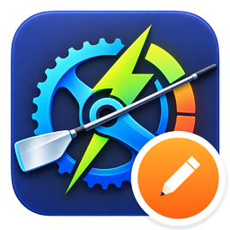
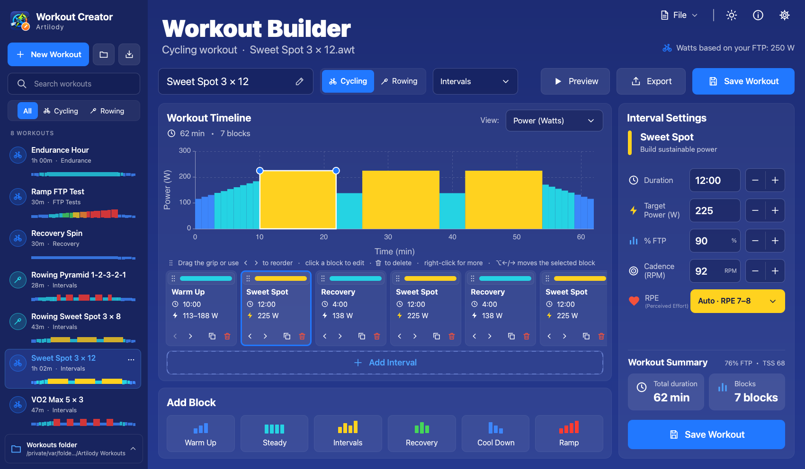
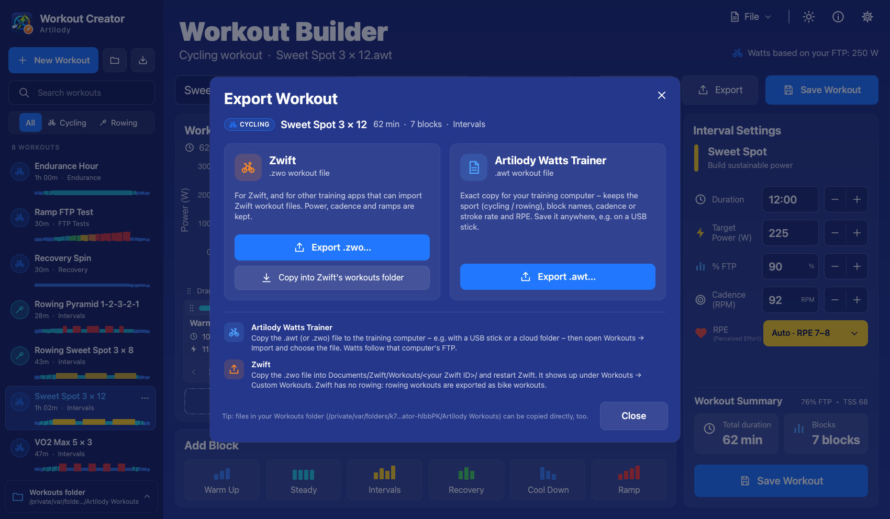
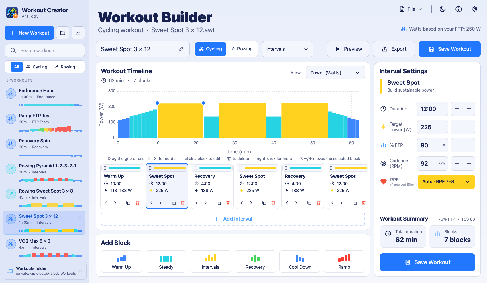

<div align="center">



# Artilody Workout Creator

**Build cycling and rowing workouts on any computer – then take them to Artilody Watts Trainer or Zwift.**

</div>

<p align="center">
  
</p>

Artilody Workout Creator is a small, standalone desktop app with the **same Workout Builder as
[Artilody Watts Trainer](../README.md)**: the same block cards, chart, interval settings, drag-to-reorder,
right-click menu and keyboard shortcuts. You don't need a trainer, Bluetooth or a database. Every workout is a
file, so you can design workouts on your laptop and copy them to your training computer or to Zwift.

## Features

- **Same editor as the app.** Warm up, steady, intervals (3 × work/recovery), recovery, cool down and ramp
  blocks. You set duration, power in watts or % FTP, ramps (start → end power), cadence (rowing: stroke rate)
  and RPE. Reorder with the grip strip, the ‹ › buttons, the right-click menu or Alt/⌥ + ←/→. The workout
  chart can show watts or % FTP, and you can preview the whole workout.
- **Cycling and rowing.** The *Cycling / Rowing* switch sets the sport that is saved with the workout. Rowing
  workouts are % of your **Rowing FTP**.
- **File library.** All `.awt` (and, if you want, Zwift `.zwo`) files in your **Workouts folder**
  (default `~/Documents/Artilody Workouts`, which you can change) are listed with name, sport, duration,
  category and a mini power profile. You can search and filter by sport (*All / Cycling / Rowing*), and the
  list refreshes by itself when files change.
- **File actions.** New (cycling / rowing), Open…, Save, Save As…, Duplicate, Rename, Delete (to the trash,
  after you confirm), Import `.zwo` / `.awt`… (files with several workouts are split into one file each),
  Export `.zwo` for Zwift, Export `.awt`… to anywhere (e.g. a USB stick), *Copy into Zwift's workouts folder*
  (when Zwift is installed) and *Show in Finder / Explorer*.
- **Unsaved changes are safe.** The title, the file list and the subtitle show when you have edits. If you
  close the app, open another workout or start a new one, it asks whether to *Save* or *Don't Save* (or
  *Cancel*).
- **Settings.** Cycling FTP, Rowing FTP and default cadence (these are only used to show watts while you edit),
  dark / light theme and the Workouts folder.
- **Keyboard.** ⌘/Ctrl + N new cycling workout, ⇧⌘/Ctrl+Shift + N new rowing workout, ⌘/Ctrl + O open,
  ⌘/Ctrl + S save, ⇧⌘/Ctrl+Shift + S save as, ⌘/Ctrl + E export, ⌘/Ctrl + I import, ⌘/Ctrl + F search,
  ⌘/Ctrl + , settings.

<p align="center">
  
  
</p>

## Using your workouts

Workouts are stored as **% of FTP**, so they scale to the FTP of whoever rides them. The FTP set in the creator
only changes the watts you see while you edit.

### In Artilody Watts Trainer (on your training computer)

1. Copy the `.awt` file to the training computer, for example with a USB stick, a cloud folder or e-mail.
   You can export it with **Export → Export .awt…** or copy it straight from your Workouts folder.
2. In Artilody Watts Trainer open **Workouts → Import** and choose the file. The workout appears in your
   library with its sport (cycling / rowing), block names, cadence / stroke rate and RPE.

Artilody Watts Trainer can also import the `.zwo` files.

### In Zwift

1. Use **Export → Export .zwo…**, or **Copy into Zwift's workouts folder** if Zwift is installed on the same
   computer.
2. Put the `.zwo` file into `Documents/Zwift/Workouts/<your Zwift ID>/` (the numbered folder) and restart Zwift.
3. In Zwift the workout is listed under **Workouts → Custom Workouts**.

Zwift only knows bike and run workouts, so **rowing workouts are exported as bike workouts**. Their % FTP blocks
are kept, but the sport is not.

### File formats

- **`.awt`** – the native Artilody Watts Trainer format (UTF-8 JSON, `"format": "artilody-watts-trainer/workout"`,
  version 1). It is written by exactly the same code as the app's own export (`src/core/WorkoutIO`), so the app
  imports it without changes. Each file in the Workouts folder holds one workout.
- **`.zwo`** – the Zwift workout format (XML). It keeps power, ramps and cadence, but block names, RPE and the
  sport are lost.

## How it is built (shared code)

The creator is a separate CMake project inside the Artilody Watts Trainer repository. It shares as much as
possible with the app, so both edit workouts the same way and write the same files:

| Shared (compiled / bundled from the main repo) | Creator only (this folder) |
|---|---|
| `src/core`: `Workout`, `Interval`, `Zones`, `TimeFormat`, `WorkoutIO` (.awt / .zwo), `WorkoutBuilder` (the Builder back-end) and the `BuilderBackend` interface | `src/WorkoutFileLibrary` (the folder library), `src/CreatorBackend` (BuilderBackend on top of files), `src/CreatorSettings` (QSettings), `src/DemoWorkouts`, `src/main.cpp` |
| `qml/pages/BuilderPage.qml` (the whole Builder page) and `qml/Theme.qml` | `qml/Main.qml`, `LibraryPanel.qml`, `LibraryItem.qml`, `CreatorTopBar.qml`, `ExportDialog.qml`, `CreatorSettingsDialog.qml`, `RenameDialog.qml`, `HelpDialog.qml`, `UsageNote.qml` |
| `qml/components`: WorkoutChart, Card, AppButton, IconButton, AppTextField, AppComboBox, AppMenu(+Item/Separator), SegmentedControl, SportBadge, CategoryBadge, StatTile, StepperField, UnitSpinBox, ToggleSwitch, ZoneLegend, PageHeader, AppDialog, Toast, Icon, `dialogs/ConfirmDialog.qml` | |

`WorkoutBuilder` gets FTP, zones, cadence and workout storage through the abstract `BuilderBackend` interface
(`src/core/BuilderBackend.h`). The app uses `AppBuilderBackend` (SQLite database + profile), and the creator uses
`CreatorBackend` (files + settings). No database code is compiled into the creator.

### Standalone repository

The creator is also published as its own repository,
[Artilody-Workout-Creator](https://github.com/shenphenchoedron-hue/Artilody-Workout-Creator), with release
builds for Windows, macOS and Linux. That repository carries a copy of the shared files above in `shared/`
(same relative layout: `shared/src/core/...`, `shared/qml/...`). CMake finds them automatically: the
`ARTILODY_SHARED_DIR` cache variable defaults to the parent folder when `../src/core/WorkoutIO.h` exists (this
repository) and to `shared/` otherwise. After changing shared code here, refresh the standalone checkout with

```bash
"Artilody Workout Creator/tools/sync_shared.sh" <path to Artilody-Workout-Creator checkout>
```

The shared code is part of Artilody Watts Trainer and licensed under GPL-3.0.

## Building

You need CMake ≥ 3.21, a C++17 compiler and **Qt ≥ 6.4** (Core, Gui, Qml, Quick, QuickControls2; Qt Test for the
tests). The commands are run from the repository root, because the creator compiles shared sources from
`../src` and `../qml`.

### macOS

```bash
cmake -S "Artilody Workout Creator" -B build-creator -DCMAKE_PREFIX_PATH=$HOME/Qt/6.8.3/macos -DCMAKE_BUILD_TYPE=Release
cmake --build build-creator -j8
ctest --test-dir build-creator --output-on-failure
open "build-creator/Artilody Workout Creator.app"
```

To make a standalone bundle and a DMG:

```bash
APP="build-creator/Artilody Workout Creator.app"
macdeployqt "$APP" -qmldir="Artilody Workout Creator/qml" -qmldir=qml -always-overwrite
rm -rf "$APP/Contents/PlugIns/sqldrivers"            # no SQL in the creator
/usr/libexec/PlistBuddy -c "Set :LSMinimumSystemVersion 12.0" "$APP/Contents/Info.plist"
xattr -cr "$APP" && codesign --force --deep --sign - "$APP"
hdiutil create -volname "Artilody Workout Creator" -srcfolder <folder with the .app + Applications link> \
        -format UDZO ArtilodyWorkoutCreator-1.0.0-macOS.dmg
```

### Windows (MSVC)

```bat
cmake -S "Artilody Workout Creator" -B build-creator -DCMAKE_PREFIX_PATH=C:\Qt\6.8.3\msvc2022_64
cmake --build build-creator --config Release
ctest --test-dir build-creator -C Release
windeployqt --qmldir "Artilody Workout Creator\qml" --qmldir qml "build-creator\Release\Artilody Workout Creator.exe"
```

The executable is a GUI (WIN32) app with the icon from `assets/icons/app-icon.ico`.

### Linux (Debian / Ubuntu / Raspberry Pi OS)

```bash
sudo apt install cmake g++ qt6-base-dev qt6-declarative-dev qml6-module-qtquick-controls \
     qml6-module-qtquick-layouts qml6-module-qtquick-dialogs qml6-module-qtqml-workerscript \
     qml6-module-qtquick-templates qml6-module-qtquick-window
cmake -S "Artilody Workout Creator" -B build-creator -DCMAKE_BUILD_TYPE=Release
cmake --build build-creator -j4
sudo cmake --install build-creator     # /usr/local/bin/artilody-workout-creator + .desktop file + icons
```

### Developer notes

- `WATT_SCREENSHOT_DIR=<dir>` (with `QT_QPA_PLATFORM=offscreen`) uses temporary settings and a temporary
  Workouts folder with demo workouts, saves `main.png`, `rowing.png`, `light.png`, `export.png`,
  `menu-file.png`, `menu-block.png`, `menu-filemenu.png`, `settings.png` and `small.png`, and then quits. It
  never touches your own settings or files.
- `AWC_SETTINGS_FILE=<file.ini>` and `AWC_WORKOUTS_DIR=<dir>` override where settings are stored and which
  Workouts folder is used.
- `tools/make_icon.py` (needs Pillow) rebuilds the icon set (`.icns`, `.ico`, Linux PNGs, in-app PNG) from `assets/icons/creator-icon-source.png`.

## License

GPL-3.0, the same license as Artilody Watts Trainer. See [`../LICENSE`](../LICENSE).
