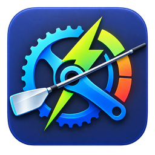
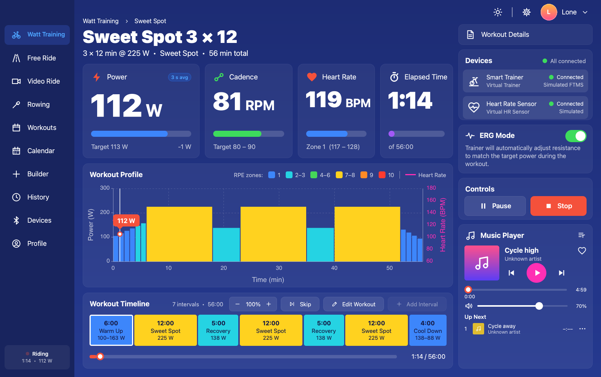
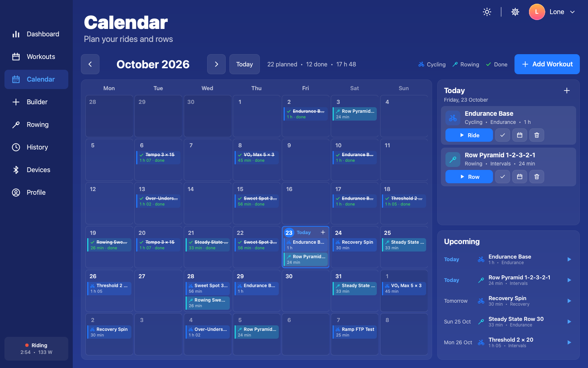
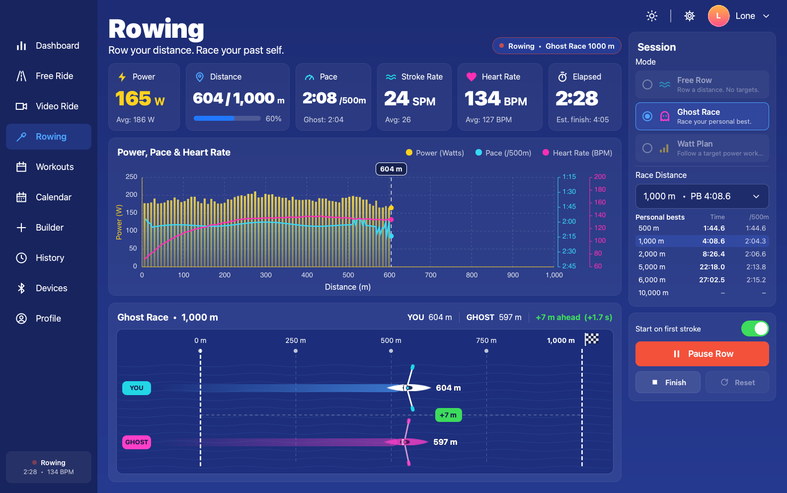
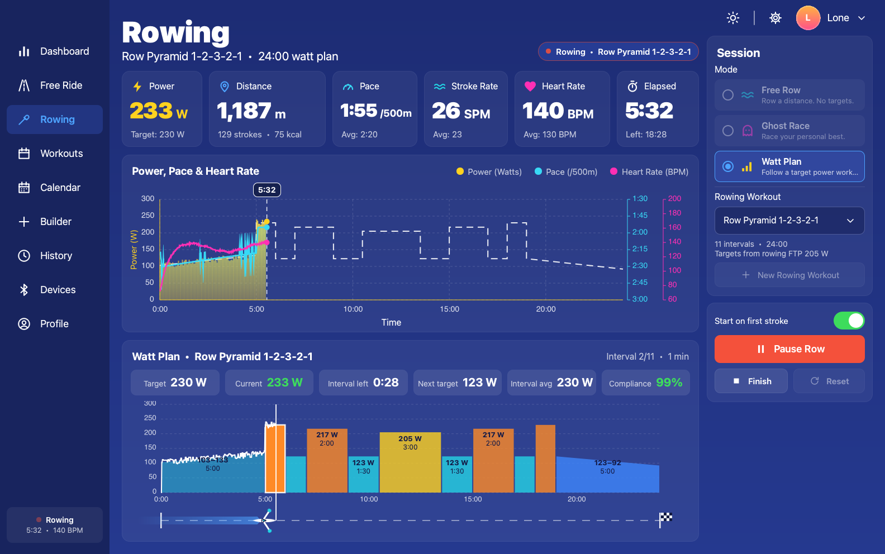
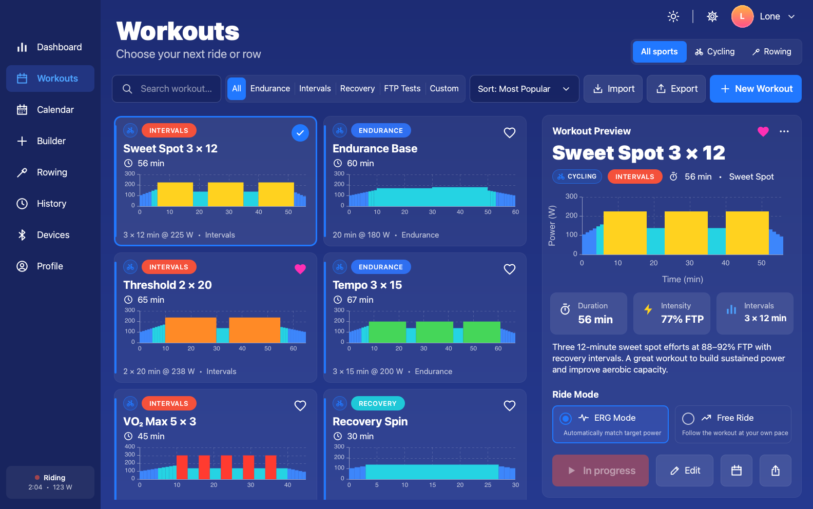
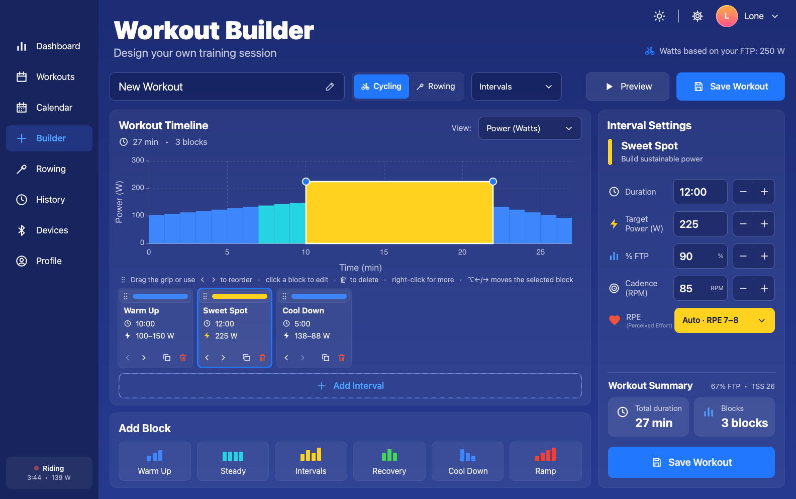
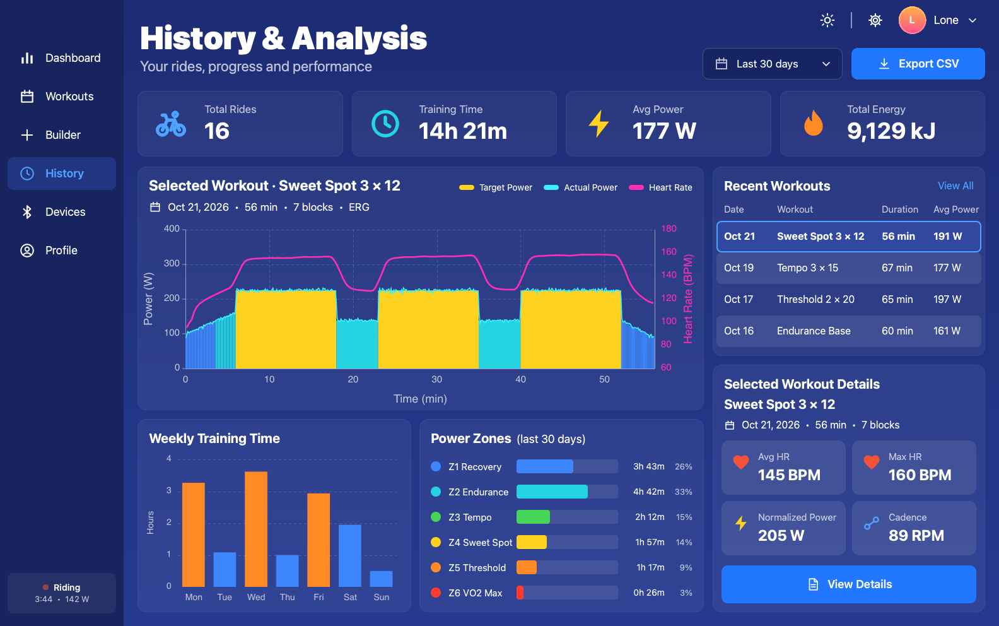
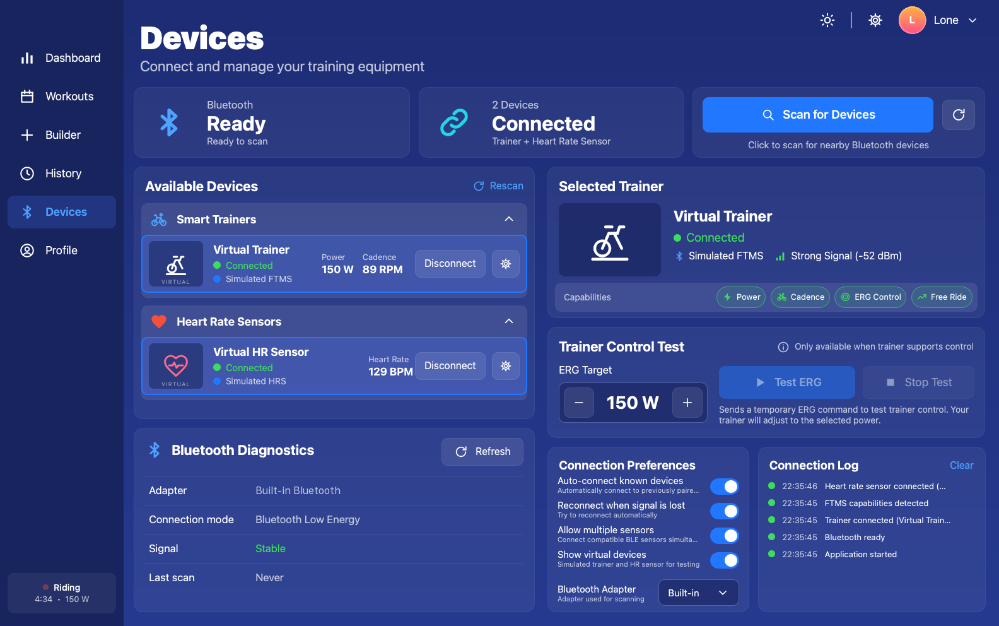
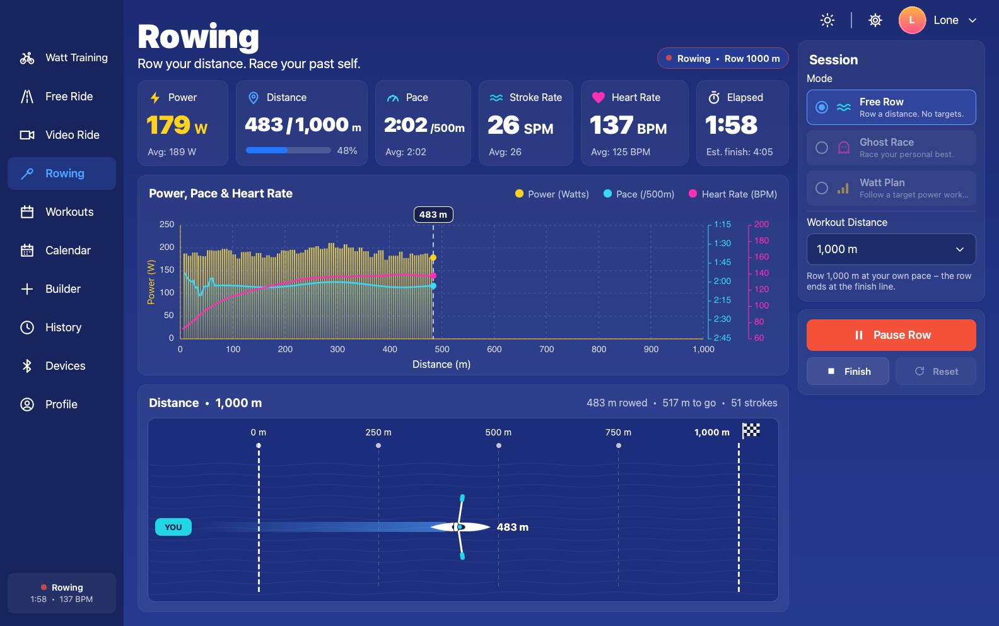

<div align="center">



# Artilody Watts Trainer

**Free, open-source, offline power training for indoor cycling and rowing – with your Bluetooth smart trainer or Concept2 PM5.**

[](https://github.com/shenphenchoedron-hue/Artilody-Watts-Trainer/releases/latest)
[](https://github.com/shenphenchoedron-hue/Artilody-Watts-Trainer/actions/workflows/release.yml)
[](LICENSE)
[](#download--install)
[](https://www.qt.io/)

[Download](#download--install) · [User manual](docs/Artilody-Watts-Trainer-Manual.pdf) · [Quick start](#quick-start) · [Build from source](#building-from-source) · [Report a bug](https://github.com/shenphenchoedron-hue/Artilody-Watts-Trainer/issues)

</div>

<p align="center">
  
</p>

Artilody Watts Trainer is a desktop app for structured, power-based indoor cycling. It connects to Bluetooth LE smart trainers (FTMS) and heart-rate sensors, sets the trainer resistance for you in **ERG mode**, and saves every ride to a local database on your computer. It also connects to **Concept2 rowers (PM5)** for free rows, watt-plan workouts and ghost races against your personal best, and a **training calendar** lets you plan rides and rows ahead. You don't need an account, a subscription or an internet connection.

It is written in C++17 with Qt 6 / QML and runs on **Windows**, **macOS**, **Linux (Debian / Ubuntu)** and **Raspberry Pi OS**.

---

## What's new in 1.1.1

- **Music playlist fix** – the *Up Next* list on the Dashboard music card now stays inside the card and scrolls when space is tight, instead of drawing past the card frame; the Music Library lists have scrollbars and long names are shortened with "…". See the [1.1.1 release notes](https://github.com/shenphenchoedron-hue/Artilody-Watts-Trainer/releases/tag/v1.1.1).

## What's new in 1.1.0

- **Workout calendar** – plan rides and rows by day, drag to move, start with a double-click, automatic tick-off.
- **Concept2 PM5 rowing** – *Free Row*, *Watt Plan* and *Ghost Race* against your personal best, plus a *Virtual Rower*.
- **Sport type & Rowing FTP** – cycling and rowing workouts, a sport filter in Workouts and History, a separate rowing FTP.
- **FIT export** – upload rides and rows to Garmin Connect, Strava, TrainingPeaks, intervals.icu (rows as *indoor rowing* with distance).
- **Workout sharing** – export/import Artilody `.awt` and Zwift `.zwo` files.
- **New app icon**, larger and more readable menus, light-theme fixes and many smaller fixes.

Existing data is kept: the database is upgraded automatically on first start. See the [release notes](https://github.com/shenphenchoedron-hue/Artilody-Watts-Trainer/releases/tag/v1.1.0) for details.

---

## Contents

- [What's new in 1.1.1](#whats-new-in-111)
- [What's new in 1.1.0](#whats-new-in-110)
- [Features](#features)
- [Screenshots](#screenshots)
- [Download & install](#download--install)
- [User manual](#user-manual)
- [Quick start](#quick-start)
- [Sharing workouts](#sharing-workouts)
- [Supported hardware](#supported-hardware)
- [Privacy](#privacy)
- [Building from source](#building-from-source)
- [Architecture](#architecture)
- [Contributing](#contributing)
- [License](#license)
- [Acknowledgements](#acknowledgements)

## Features

### Ride
- **Live dashboard** with power, cadence, heart rate and elapsed/remaining time.
- **Workout chart** with targets coloured by RPE/power zone, your heart-rate curve and a position marker, plus a timeline of the intervals.
- **On-the-fly control**: change the intensity in ±5 % steps, skip the current interval, and turn ERG on or off during the ride.
- **Start on pedaling**: the workout loads and waits until you start pedaling (cadence ≥ 20 rpm, or power ≥ 30 W on trainers that don't report cadence). Press **Start now** to start it yourself.
- **ERG or Free Ride**: in ERG mode the app sends the target power to the trainer. In Free Ride you still see the targets, but the trainer simulates a flat road and you control the effort.

### Plan
- **Workout calendar**: a month view of your training plan. Click a day or a planned workout to select it; double-click a day, click its **+** or press **Add Workout** to add a workout (search, Cycling/Rowing filter, optional notes). Drag planned workouts between days, and right-click (or press and hold) for *Ride/Row this workout*, *Mark as completed*, *Move to…*, *Move to next day* and *Remove* (removing asks for confirmation). Double-click a workout or press **Ride**/**Row** in the side panel to start it: cycling workouts open on the Dashboard, rowing workouts as a watt plan on the Rowing page. A side panel shows the selected day and your upcoming workouts. When you complete a workout you started from the calendar, exactly that plan entry is ticked off (even if it was planned for another day), and a completed workout started elsewhere ticks off a matching open entry on that day. Stopped or aborted rides don't count, and deleting a ride in History reopens its plan entry.

<p align="center">
  
</p>

### Row (Concept2 PM5)
- **Concept2 PM5 over Bluetooth LE**: on the PM5 choose *More Options → Turn Wireless ON → Connect Device*, then connect it under **Devices → Rowers (Concept2 PM5)**. A **Virtual Rower** lets you try everything without a rower. Opening the Rowing page gets the rower ready (the row starts with your first stroke); if you leave the page before you start, the setup is cleared so a stroke can't start a row in the background. Heart rate comes from a connected heart-rate strap if you have one, otherwise from the PM5.
- **Free Row**: row a set distance (or open-ended) and watch your boat move along the course, with power, distance, pace /500 m, stroke rate, heart rate and a live power/pace/heart-rate chart.
- **Watt Plan**: row any rowing workout from your library. The interval blocks are shown at the bottom with your position, and you see target vs. actual watts, the time left in the interval, the next target, interval average and a compliance score. The PM5 has no ERG mode, so you follow the target by feel.
- **Ghost Race**: race your own personal best over 500 m, 1k, 2k, 5k, 6k, 10k or a custom distance. A ghost boat replays your record stroke by stroke, and the gap is shown in metres and seconds. A new best is saved automatically and the personal-bests table keeps your records. A time is only saved as a personal best if the piece was rowed without a pause and the time is plausible.
- The row starts on your first stroke (or press **Start now**), with **Pause** (or <kbd>Space</kbd>), **Finish** and **Reset**. Rows are saved to History as *Rowing* with distance and can be exported as FIT/CSV.
- **Rowing FTP**: every profile has a separate rowing FTP; watt-plan targets are a percentage of it.

<table>
  <tr>
    <td align="center" width="50%">
      <br>
      <sub><b>Ghost Race</b>: race your personal best</sub>
    </td>
    <td align="center" width="50%">
      <br>
      <sub><b>Watt Plan</b>: follow target watts on the erg</sub>
    </td>
  </tr>
</table>

### Train
- **Workout library** with 8 built-in workouts (Sweet Spot, Endurance, VO₂ Max, Threshold, Tempo, Over-Unders, Recovery and a Ramp FTP Test). It has search, category filters, sorting, favourites and a preview, and lets you duplicate or delete workouts. Built-in workouts can't be deleted.
- **Cycling and rowing workouts**: every workout has a sport. The library shows *Cycling*/*Rowing* badges and a sport filter, rowing workouts have a **Row Workout** button, and the Builder has a Cycling/Rowing selector (rowing targets use your rowing FTP and stroke rate in SPM). Any workout can be added to the calendar.
- **Workout Builder**, a visual editor: add blocks from presets (Warm Up, Steady, Intervals, Recovery, Cool Down, Ramp) and set the duration, target in watts or % FTP, ramp end power, cadence and RPE. The preview updates as you edit. If you edit a built-in workout, it is saved as your own copy. **Reorder** a block by dragging the ⋮⋮ grip strip at the top of its card (a blue line shows where it lands), with the ‹ / › buttons on the card, from the right-click menu (Move earlier/later, Move to start/end, Duplicate, Delete) or with Alt+←/→ (⌥←/→ on a Mac) for the selected block. **Delete** a block with the red trash button on its card. A hint line above the block list and tooltips on every button explain this.
- **Share workouts**: export any workout as an Artilody `.awt` file or a Zwift `.zwo` file, export all your own workouts in one file, and import `.awt`/`.zwo` files from friends, coaches or other apps (Zwift, TrainerRoad, Golden Cheetah, MyWhoosh, …). See [Sharing workouts](#sharing-workouts).
- **FTP test**: when you finish the built-in *Ramp FTP Test*, the app estimates your FTP as 75 % of your best 1-minute power and asks whether to update your profile. You can also pick any FTP test ride in History and use it as your FTP.

### Analyse
- **History** with a sport filter (All / Cycling / Rowing), totals, a chart of the selected ride (target, actual power and heart rate), weekly training time and time in zones.
- **Ride metrics**: average/max power, Normalized Power (NP), Intensity Factor (IF), Training Stress Score (TSS) and more.
- **FIT export** for Garmin Connect, Strava, TrainingPeaks, intervals.icu and other platforms: export the selected ride, or every ride in the selected period as one `.fit` file per ride. The file contains 1-second power, heart rate and cadence plus a session summary (NP, TSS, IF, threshold power, work).
- **CSV export** of every second of a ride, or a summary of all rides. You can also delete rides.

### Devices & profiles
- **Bluetooth LE** scanning for FTMS smart trainers (power, cadence, speed, ERG target power, flat-road simulation) and heart-rate sensors (HRS).
- Auto-connect and auto-reconnect, Bluetooth adapter selection, an ERG control test and a connection log.
- A **virtual trainer and heart-rate sensor**, so you can try every feature without hardware.
- **Concept2 PM5 rowers** (Concept2's own Bluetooth rowing service) with live power, pace and stroke rate on the Devices page.
- **Multiple rider profiles**, each with weight, FTP, rowing FTP, max/resting HR, preferred cadence, default mode and an avatar. Power zones can be edited, and heart-rate zones are calculated with the Karvonen method.

### Extras
- **Music player** for your own files (mp3, m4a, flac, wav, ogg, …) with playlists, favourites, shuffle/repeat and album art. Two sample tracks are included.
- **Light and dark theme.**
- Larger, easy-to-read menus (Workouts sort/export/**⋯** menus, History **Export**, the Calendar's right-click/press-and-hold menu).
- **Keyboard shortcuts:** <kbd>Space</kbd> pauses/resumes a ride on the Dashboard (and starts a waiting workout) or a row on the Rowing page; <kbd>Esc</kbd> closes dialogs.
- The **UI scales** to small screens such as the official 7" Raspberry Pi display (800 × 480).
- **Fully offline**: all data is stored in a local SQLite database.

## Screenshots

<table>
  <tr>
    <td align="center" width="50%">
      <br>
      <sub><b>Workouts</b>: library with filters, favourites and preview</sub>
    </td>
    <td align="center" width="50%">
      <br>
      <sub><b>Builder</b>: visual block editor with live preview</sub>
    </td>
  </tr>
  <tr>
    <td align="center" width="50%">
      <br>
      <sub><b>History</b>: ride analysis, zones, NP / IF / TSS</sub>
    </td>
    <td align="center" width="50%">
      <br>
      <sub><b>Devices</b>: Bluetooth trainers and heart-rate sensors</sub>
    </td>
  </tr>
  <tr>
    <td align="center" width="50%">
      <br>
      <sub><b>Free Row</b>: row a distance and watch the boat move</sub>
    </td>
    <td align="center" width="50%">
      <br>
      <sub><b>Calendar</b>: plan rides and rows, drag to move</sub>
    </td>
  </tr>
</table>

## Download & install

The current version is **1.1.1**. All files are on the **[Releases page](https://github.com/shenphenchoedron-hue/Artilody-Watts-Trainer/releases/latest)**; direct links:

| Platform | Download |
|---|---|
| **Windows 10/11** (64-bit), installer | [`ArtilodyWattsTrainer-1.1.1-windows-x64-setup.exe`](https://github.com/shenphenchoedron-hue/Artilody-Watts-Trainer/releases/download/v1.1.1/ArtilodyWattsTrainer-1.1.1-windows-x64-setup.exe) |
| **Windows 10/11** (64-bit), portable | [`ArtilodyWattsTrainer-1.1.1-windows-x64.zip`](https://github.com/shenphenchoedron-hue/Artilody-Watts-Trainer/releases/download/v1.1.1/ArtilodyWattsTrainer-1.1.1-windows-x64.zip) |
| **macOS 12 Monterey or newer** (Apple Silicon and Intel) | [`ArtilodyWattsTrainer-1.1.1-macOS-universal.dmg`](https://github.com/shenphenchoedron-hue/Artilody-Watts-Trainer/releases/download/v1.1.1/ArtilodyWattsTrainer-1.1.1-macOS-universal.dmg) |
| **Ubuntu 24.04 LTS** (amd64) | [`artilody-watts-trainer_1.1.1_ubuntu24.04_amd64.deb`](https://github.com/shenphenchoedron-hue/Artilody-Watts-Trainer/releases/download/v1.1.1/artilody-watts-trainer_1.1.1_ubuntu24.04_amd64.deb) |
| **Debian 12 Bookworm** (amd64) | [`artilody-watts-trainer_1.1.1_debian12_amd64.deb`](https://github.com/shenphenchoedron-hue/Artilody-Watts-Trainer/releases/download/v1.1.1/artilody-watts-trainer_1.1.1_debian12_amd64.deb) |
| **Raspberry Pi OS 64-bit Bookworm** (Pi 3 / 4 / 5 / 400) | [`artilody-watts-trainer_1.1.1_raspberrypi-os-bookworm_arm64.deb`](https://github.com/shenphenchoedron-hue/Artilody-Watts-Trainer/releases/download/v1.1.1/artilody-watts-trainer_1.1.1_raspberrypi-os-bookworm_arm64.deb) |
| User manual (PDF) | [`Artilody-Watts-Trainer-Manual.pdf`](https://github.com/shenphenchoedron-hue/Artilody-Watts-Trainer/releases/download/v1.1.1/Artilody-Watts-Trainer-Manual.pdf) |
| Checksums | [`SHA256SUMS.txt`](https://github.com/shenphenchoedron-hue/Artilody-Watts-Trainer/releases/download/v1.1.1/SHA256SUMS.txt) – verify with `sha256sum -c SHA256SUMS.txt --ignore-missing` (Linux) or `shasum -a 256 <file>` (macOS) |

**System requirements:** Windows 10/11 (x64) · macOS 12 Monterey or newer (Apple Silicon or Intel) · Debian 12 or Ubuntu 24.04 LTS (amd64) · Raspberry Pi OS 64-bit Bookworm (arm64, Pi 3/4/5/400) · a Bluetooth LE adapter for real devices · minimum window size 800 × 480.

> [!TIP]
> **Upgrading from 1.0.0?** Just install the new version over the old one. Your rides, workouts, profiles and settings are kept; the database is upgraded automatically on first start.

<details>
<summary><b>Windows</b></summary>

1. Run `ArtilodyWattsTrainer-1.1.1-windows-x64-setup.exe`. It adds a Start menu entry and, if you choose, a desktop shortcut.
   If you'd rather not install anything, extract the ZIP and run `Artilody Watts Trainer.exe` from the extracted folder.
2. **SmartScreen:** the app is not code-signed yet, so Windows may show *"Windows protected your PC"*. Click **More info → Run anyway**.
3. Turn on Bluetooth under *Settings → Bluetooth & devices*. Bluetooth LE requires Windows 10 or newer.

</details>

<details>
<summary><b>macOS</b></summary>

1. Open the DMG and drag **Artilody Watts Trainer** into **Applications**.
2. **Gatekeeper:** the app is ad-hoc signed but not notarized by Apple. The first time you open it, **right-click (or Control-click) the app → Open → Open**.
   If macOS says the app is "damaged" or still won't open it, run this once:
   ```sh
   xattr -cr "/Applications/Artilody Watts Trainer.app"
   ```
3. Allow **Bluetooth access** when macOS asks. If you denied it by mistake, turn it on again under *System Settings → Privacy & Security → Bluetooth*.

</details>

<details>
<summary><b>Ubuntu 24.04 / Debian 12</b></summary>

Install the matching package with `apt`. It also installs the Qt 6 libraries the app needs:

```sh
sudo apt install ./artilody-watts-trainer_1.1.1_ubuntu24.04_amd64.deb   # Ubuntu 24.04
sudo apt install ./artilody-watts-trainer_1.1.1_debian12_amd64.deb      # Debian 12
```

Start **Artilody Watts Trainer** from the application menu or run `artilody-watts-trainer`.
Bluetooth needs the BlueZ service to be running: `sudo systemctl enable --now bluetooth`.
Ubuntu 22.04 and older are **not** supported, because they ship Qt 6.2 and the app requires Qt 6.4 or newer.

</details>

<details>
<summary><b>Raspberry Pi OS</b></summary>

Requires **Raspberry Pi OS (64-bit) Bookworm** on a Raspberry Pi 3, 4, 5 or 400. The 32-bit edition is not supported. A Pi 4 or 5 gives the smoothest UI.

```sh
sudo apt update
sudo apt install ./artilody-watts-trainer_1.1.1_raspberrypi-os-bookworm_arm64.deb
```

The built-in Bluetooth on the Pi 3/4/5 works with smart trainers and heart-rate sensors. Make sure Bluetooth is turned on in the desktop panel.

</details>

**Bluetooth requirements:** a Bluetooth LE (4.0+) adapter, either built in or a USB dongle. On Linux the app uses BlueZ. On macOS you need to allow Bluetooth access the first time you scan.

**Uninstall:** on Windows use *Settings → Apps*. On macOS move the app to the Trash. On Linux run `sudo apt remove artilody-watts-trainer`. Your rides and settings are kept in your user profile.

## User manual

The **[user manual (PDF)](docs/Artilody-Watts-Trainer-Manual.pdf)** covers every screen in detail. It is also attached to each [release](https://github.com/shenphenchoedron-hue/Artilody-Watts-Trainer/releases/latest).

## Quick start

1. **Connect your devices.** Open **Devices → Scan for Devices**, then connect your smart trainer and heart-rate sensor (and/or your Concept2 PM5 under *Rowers*). If you have no hardware, connect the **Virtual Trainer**, **Virtual HR Sensor** or **Virtual Rower** instead.
2. **Set up your profile.** Click **Profile** in the left sidebar (or open the profile menu by clicking your avatar/name at the top right and choose **Edit profile…**) to enter your weight, FTP (and rowing FTP, if you row) and heart-rate values. If you don't know your FTP, run the **Ramp FTP Test** first.
3. **Choose a workout** under **Workouts**, or create your own in **Builder**.
4. **Choose ERG or Free Ride**, then press **Start Workout**.
5. **Start pedaling.** The clock starts as soon as you pedal, or you can press **Start now**. On the dashboard, <kbd>Space</kbd> pauses and resumes (on the Rowing page too).
6. **Stop** saves the ride, and completed workouts are saved automatically. Open **History** to see the analysis, or use **Export** to save it as a FIT file (for Strava, Garmin Connect, TrainingPeaks, …) or CSV.
7. **Rowing?** Open **Rowing**, pick *Free Row*, *Ghost Race* or *Watt Plan* and take your first stroke. Use **Calendar** to plan the coming weeks.

## Sharing workouts

On the **Workouts** page, click **Export** in the filter bar (next to **Import**) and choose **Export selected workout…** to save the selected workout, or **Export all my workouts…** to save all your own workouts in one file. The selected workout can also be exported with the share button next to **Edit** at the bottom of the Workout Preview (or from its **⋯** menu). Use the **Import** button to import one or more files.

| Format | Best for | Notes |
|---|---|---|
| **`.awt`** (Artilody workout) | Sharing with other Artilody Watts Trainer users, backups | Keeps everything: name, sport (cycling/rowing), category, focus, description and every block (type, name, duration, start/end intensity, cadence, RPE). One file can hold many workouts. |
| **`.zwo`** (Zwift workout) | Zwift, TrainerRoad, Golden Cheetah, MyWhoosh and other apps | One workout per file, always cycling (rowing workouts are exported as bike workouts; imports become cycling workouts). RPE settings are not stored; on import, `IntervalsT` repeats are expanded into individual blocks, `FreeRide` and `MaxEffort` become steady blocks at 60 % / 150 % FTP. |

All intensities are stored **relative to FTP**, so a shared workout scales to the FTP of whoever imports it. Imported workouts are added to your own (*Custom*) workouts and can be edited or deleted. A workout that is already in your library is skipped, and a different workout with the same name is imported as *Name (imported)*. Files are validated before import (sizes, durations, intensities, categories).

An `.awt` file is plain UTF-8 JSON:

```json
{
  "format": "artilody-watts-trainer/workout",
  "version": 1,
  "exportedAt": "2026-10-23T12:00:00Z",
  "app": "Artilody Watts Trainer 1.1.1",
  "workouts": [
    {
      "name": "Sweet Spot 3 x 12",
      "sport": "cycling",
      "category": "Intervals",
      "focus": "Sweet Spot",
      "description": "Three 12-minute sweet spot efforts ...",
      "intervals": [
        { "name": "Warm Up", "type": "warmup", "duration": 360, "start": 0.40, "end": 0.65 },
        { "name": "Sweet Spot", "type": "interval", "duration": 720, "start": 0.90, "end": 0.90, "cadence": 90 }
      ]
    }
  ]
}
```

`sport` is `cycling` (default when missing) or `rowing`; `type` is one of `warmup`, `steady`, `interval`, `recovery`, `cooldown`, `ramp`; `duration` is in seconds; `start`/`end` are fractions of FTP (0.90 = 90 % FTP); `cadence` (RPM) and `rpe` (zone 0–5) are optional. The full description is in the [user manual](docs/Artilody-Watts-Trainer-Manual.pdf) (appendix C).

> [!NOTE]
> **About FIT files:** rides are written as FIT activity files by an independent encoder that is part of this project (no Garmin FIT SDK code is included). The files work with Garmin Connect, Strava, TrainingPeaks, intervals.icu and other platforms; upload them on the platform's website. Indoor rides contain no GPS, speed or distance. Rows are exported as **indoor rowing** activities (FIT sport *rowing*, sub-sport *indoor rowing*) with total distance, average speed, power, heart rate and stroke rate as cadence; the per-second distance curve is estimated by spreading the rowed distance in proportion to power^(1/3) (Concept2: speed ∝ power^(1/3)). FIT is a file format by Garmin; this project is not affiliated with Garmin.

## Supported hardware

**Smart trainers.** The app should work with any trainer that implements the standard Bluetooth **Fitness Machine Service (FTMS)**. Most current trainers do, for example Tacx NEO, Wahoo KICKR, Saris H3, Elite (Suito, Direto, …) and Zwift Hub. ERG control needs a trainer that supports FTMS *Set Target Power*.

**Rowers.** **Concept2 PM5** monitors (RowErg and other Concept2 machines with a PM5) over Bluetooth LE. On the PM5 choose *More Options → Turn Wireless ON → Connect Device* before scanning. The PM5 has no ERG mode, so watt plans are followed by feel. Older PM3/PM4 monitors are not supported, and BikeErg and SkiErg are not supported (the app only handles rowing data). If both a heart-rate strap and the PM5 report heart rate, the strap is used.

**Heart-rate sensors.** Any Bluetooth LE strap or armband using the standard **Heart Rate Service (HRS)** should work, for example Polar H10, Garmin HRM-Dual/HRM-Pro or Wahoo TICKR.

> [!NOTE]
> **ANT+ is not supported**, only Bluetooth LE. Older trainers that only offer a proprietary Bluetooth protocol (no FTMS) can't be controlled.

## Privacy

Artilody Watts Trainer runs **fully offline**:

- No account, no cloud and no telemetry or analytics. Nothing is uploaded: FIT, CSV and workout files are only written when you export them yourself.
- Rides and rows, profiles, workouts, the training plan, rowing records and playlists are stored in a local SQLite database (`watt-trainer.sqlite` in the user's app-data folder). The exact path is shown under **Settings** (the gear icon).
- To use a different database file, set the `WATT_DB_PATH` environment variable.

## Building from source

**Requirements:** CMake ≥ 3.21, a C++17 compiler, and **Qt ≥ 6.4** with the modules Core, Gui, Qml, Quick, QuickControls2, Sql (SQLite driver), Bluetooth (qtconnectivity) and Multimedia.

```bash
cmake -S . -B build -DCMAKE_BUILD_TYPE=Release -DCMAKE_PREFIX_PATH=<path-to-Qt>/6.x/<platform>
cmake --build build --parallel
ctest --test-dir build --output-on-failure        # unit tests
```

On Debian 12, Ubuntu 24.04 and Raspberry Pi OS Bookworm you can use the distribution's Qt packages. Then `cd build && cpack -G DEB` builds an installable `.deb`.

See **[docs/BUILDING.md](docs/BUILDING.md)** for the full package lists, platform notes for macOS (`macdeployqt`) and Windows (MSVC + `windeployqt`), CMake options and developer tips.

## Architecture

The UI and the application logic are kept completely separate. The C++ libraries have no QML or UI dependencies and are unit tested on their own.

```
src/core    watt_core         Domain model (Workout, Interval, Zones), SQLite database, ride analysis
                              (NP/IF/TSS), CSV and FIT export, workout import/export (.awt/.zwo),
                              WorkoutEngine (pure state machine), WorkoutPlanner (calendar),
                              TrainingSession, RowingSession + RowingRecords (watt_rowing),
                              SensorHub, profile/library/builder/history managers
src/ble     watt_bleprotocol  Pure FTMS/HRS/Concept2 PM5 parsing and encoding (QtCore only, fully testable)
            watt_ble          BleLink, BleTrainer, BleHeartRateSensor, Pm5Rower, simulated devices, DeviceManager
src/media   watt_media        MusicPlayer and playlists
src/app     main.cpp          Wires the modules together and exposes them to QML
qml/        Main.qml, Theme.qml, components/, pages/, dialogs/  (presentation only)
tests/      QtTest unit tests (workout, engine, analysis, database + migration, session, builder, FIT,
            workout import/export, BLE/PM5 protocol, rower device, rowing session/records, planner)
```

- **`SensorHub`** decouples training from the sensors. Real BLE devices and the simulator send measurements to the hub, and `TrainingSession` asks for ERG targets through signals. This lets the tests drive a complete ride without hardware.
- The backend is exposed to QML as **singletons** (`import Artilody.Backend`): `Training`, `Rowing`, `Planner`, `Workouts`, `Builder`, `History`, `Devices`, `Sensors`, `Profiles` and `Music`.

## Contributing

Contributions are welcome:

- **Bugs and ideas:** open an [issue](https://github.com/shenphenchoedron-hue/Artilody-Watts-Trainer/issues). For device problems, include your OS, trainer or sensor model and the connection log from the Devices page.
- **Pull requests:** keep changes focused, follow the existing code style, keep UI code in `qml/` and logic in `src/`, and add or update tests in `tests/`. Make sure `ctest` passes before you submit.
- **Trainer compatibility reports** are especially useful. Let us know which trainers and sensors work for you.

## License

Artilody Watts Trainer is free software, licensed under the **GNU General Public License v3.0**. See [`LICENSE`](LICENSE) for details.

## Acknowledgements

- Built with the [Qt](https://www.qt.io/) framework (Qt Quick, Qt Bluetooth, Qt Multimedia, Qt SQL), used under the LGPL/GPL.
- Data storage by [SQLite](https://sqlite.org/).
- Uses the Bluetooth SIG's open **Fitness Machine** and **Heart Rate** service specifications and Concept2's public *PM5 Bluetooth Smart Interface Definition*. Concept2, PM5 and RowErg are trademarks of Concept2, Inc.; this project is not affiliated with Concept2.
- The training metrics NP, IF and TSS follow the widely used definitions by Dr. Andrew Coggan.
- FIT is a file format by Garmin; the FIT encoder in this project was written independently. Zwift is a trademark of Zwift, Inc.; `.zwo` support is for interoperability only. This project is not affiliated with Garmin or Zwift.
