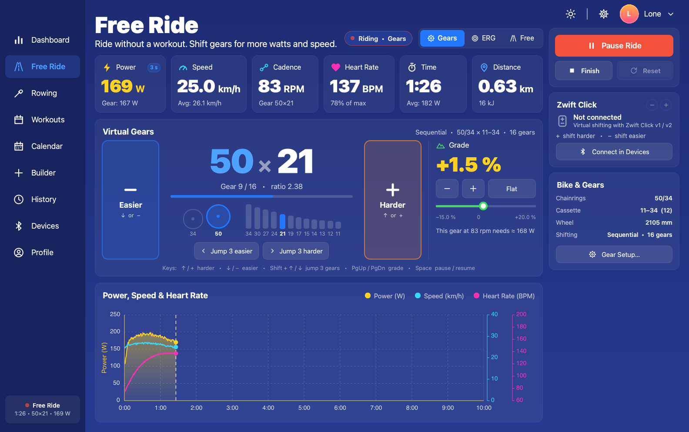
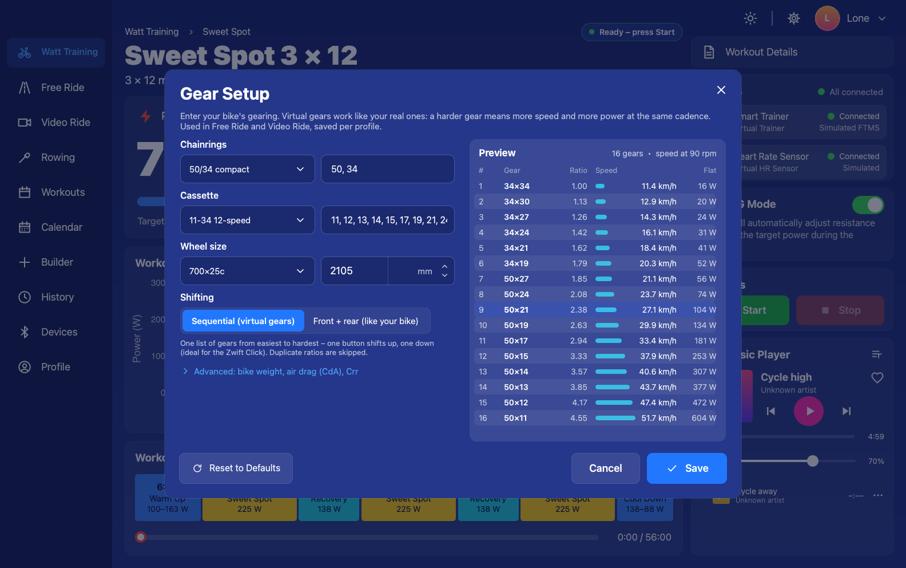
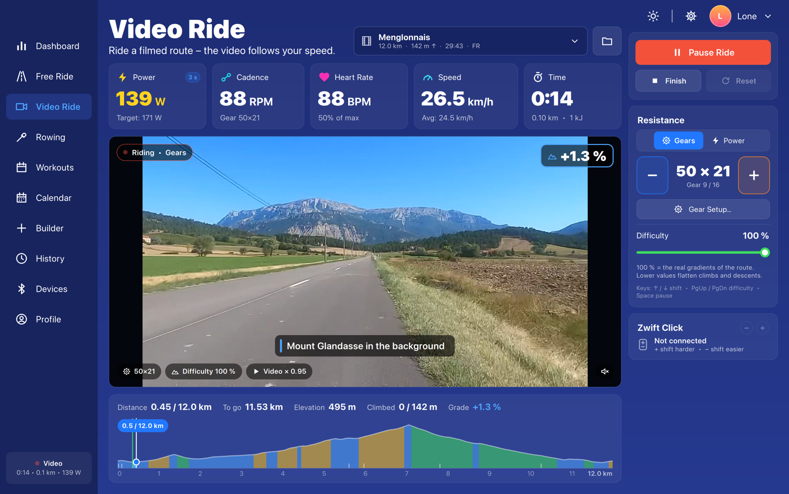
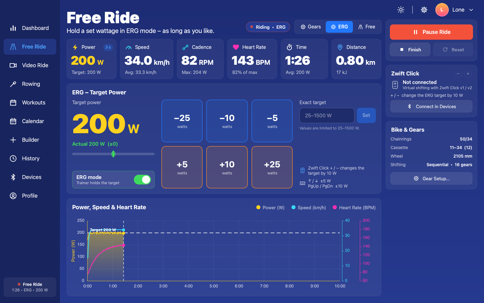
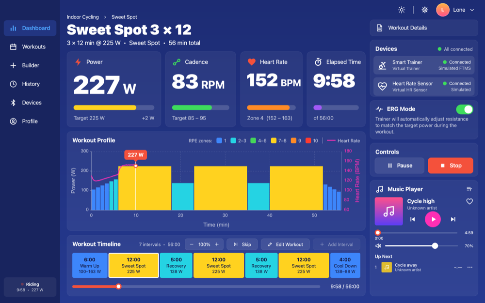

<div align="center">


# Artilody Watts Trainer

**Free, open-source, offline power training for indoor cycling and rowing – with your Bluetooth smart trainer or Concept2 PM5.**

[](https://github.com/shenphenchoedron-hue/Artilody-Watts-Trainer/releases/latest)
[](https://github.com/shenphenchoedron-hue/Artilody-Watts-Trainer/actions/workflows/release.yml)
[](LICENSE)
[](#download--install)
[](https://www.qt.io/)

[Download](#download--install) · [User manual](docs/Artilody-Watts-Trainer-Manual.pdf) · [Quick start](#quick-start) · [Build from source](#building-from-source) · [Report a bug](https://github.com/shenphenchoedron-hue/Artilody-Watts-Trainer/issues)

</div>

<p align="center">
  
</p>

Artilody Watts Trainer is a desktop app for structured, power-based indoor cycling and rowing. It connects to Bluetooth LE smart trainers (FTMS), heart-rate sensors, Zwift Click controllers and **Concept2 PM5** rowers, sets the trainer resistance for you, and saves every ride and row to a local database on your computer. You don't need an account, a subscription or an internet connection.

It is written in C++17 with Qt 6 / QML and runs on **Windows**, **macOS**, **Linux (Debian / Ubuntu)** and **Raspberry Pi OS**.

### At a glance

| | |
|---|---|
| **Workouts & ERG** | Ride structured workouts – the trainer holds the target watts in ERG mode; intensity ±5 %, skip interval, manual Start (never on pedaling), FTP test. 8 built-in workouts plus your own. |
| **Training calendar** | Plan workouts, **Free Rides** and **Video Rides** by day, drag to move, start them from the calendar; entries are ticked off automatically. |
| **Workout Builder** | Visual block editor (watts or % FTP, ramps, cadence, RPE); share workouts as `.awt` or Zwift `.zwo` files. Create workouts on any computer with the companion **[Artilody Workout Creator](https://github.com/shenphenchoedron-hue/Artilody-Workout-Creator)**. |
| **Free Ride & virtual shifting** | Ride a road with a grade or hold an ERG wattage; with a **Zwift Click** you shift **Zwift's 24 virtual gears** – on trainers with the Zwift trainer protocol (Zwift Hub, Jetblack Victory, …) automatically through that protocol, otherwise as an FTMS gradient. Nothing to set up. |
| **Video Ride (Real Life Video)** | Ride filmed routes (video + GPS) at the speed you ride, with gradient simulation or ERG – and optionally a watts workout with **Workout ERG** on top. |
| **Rowing (Concept2 PM5)** | Free Row, Watt Plan and Ghost Race against your personal best over Bluetooth LE. |
| **History & export** | NP / IF / TSS, time in zones, charts; export to **FIT** (Strava, Garmin Connect, TrainingPeaks, intervals.icu) and CSV. |
| **Music, profiles & more** | Built-in music player, multiple rider profiles with zones, light/dark theme, virtual devices to try everything without hardware. |
| **Platforms** | Windows 10/11, macOS 12+ (Apple Silicon & Intel), Debian 12, Ubuntu 24.04 and **Raspberry Pi OS** (Pi 3/4/5/400, scales down to the 7" display). Fully offline. |

---

## What's new in 1.3.6

A follow-up test release for **virtual shifting with the Zwift trainer protocol** on the **Jetblack Victory**: the start was fine in 1.3.5, but shifting up still gave a heavy jump before the resistance settled.

- **Smoother shifting up** – a virtual shift to a harder gear ramps in over 1.5 s instead of at once (the trainer's inertia emulation turned a sudden +9 % into a power spike); shifting easier acts at once.
- **No second, delayed step after a shift** – the bike's real gear on the trainer is the median of the ride's measurements and changes only beyond 6 % (the Victory's coarse, lagging cadence scattered single measurements over 3.4 … 4.4 for a chain on 44×11, which moved the compensation a few seconds after a shift). A real chain shift is still picked up after three measurements; nothing is measured for 3 s after a gear change.
- No database change – install over 1.3.5 (or older) and keep all your data. See the [1.3.6 release notes](https://github.com/shenphenchoedron-hue/Artilody-Watts-Trainer/releases/tag/v1.3.6).

<details>
<summary><b>What's new in 1.3.5</b> – virtual gears adapted to the real gear on the trainer, light start on the flat</summary>

A test release for the **Zwift trainer protocol with virtual shifting** (Zwift Click), made for the **Jetblack Victory**: with the bike in a hard real gear (e.g. 44×11) every virtual gear rode ~1.6× too hard – 400 W to get going, ~350 W in gear 12 at 80 rpm.

- **Zwift protocol: virtual gears adapted to the real gear on the trainer** – with the bike in a hard real gear (e.g. 44×11) every virtual gear on the Jetblack Victory rode ~1.6× too hard: 400 W to get going, ~350 W in gear 12 at 80 rpm. The app measures the real gear from the trainer's speed and cadence and sends each virtual gear × 2.43 / real gear. The 2.43 (34×14 on a 14T Zwift Cog, SHIFTR's standard ratio) is a **model assumption** fitted to the Victory's logs – not a published Zwift spec; verifying the trainer's speed does not verify the formula or the load. How it measures: one coherent update per trainer packet (power, cadence, speed with their age – not the split change signals), windows of ≥ 2.5 s while **actively pedaling** (≥ 20 W; freewheeling never measures), ratio within 5 % and cadence within 8 %. Whether the speed is the flywheel's is **tested** on every ≥ 10 % change of the sent gear; the verdict (flywheel / follows the gear / unknown) and the real gear are **saved per trainer** – a gear-derived speed keeps the compensation off after reconnecting; *Bluetooth diagnostics → Real gear on the trainer → Measure again* resets it. An unverified first value is applied **provisionally** (never saved) and dropped after 20 s without verification. While the real gear is unknown the hub path sends a **light gear** (× 0.5, gear 12 ≈ gear 5) – no timeout to the full ratio – and every change (light ↔ compensated, new factor, compensation dropped) **ramps over 4 s from the last requested ratio** (the latest command – not a setting the trainer confirmed). The soft start treats 0 rpm and 0 W as freewheeling: a flywheel still spinning above 10 km/h no longer ends its waiting (that made it – and the light gear – cycle every ~5 s during a coast). The real gear in use is the **median** of the ride's windows and changes only beyond 6 % (the Victory's coarse, lagging cadence scattered single windows over 3.4 … 4.4 for a chain on 44×11, which used to add a second, heavier step a few seconds after a shift); a real chain shift (three windows in a row ≥ 8 % off) takes over at once, and nothing is measured for 3 s after the sent gear changed. **Shifting harder ramps in over 3 s** (the trainer accelerates the virtual 77 kg bike and rider to the higher speed – over 1.25 s that was a spike of +80 … 110 W); shifting easier acts at once. A power check switches the compensation off if the trainer calibrates the real gear itself (Zwift Hub). Diagnostics: `GEAR` / `RES` log lines, `hubGearFactor` in the settings line, a *Zwift protocol real gear* line in the report.
- No database change – install over 1.3.4 (or older) and keep all your data. See the [1.3.5 release notes](https://github.com/shenphenchoedron-hue/Artilody-Watts-Trainer/releases/tag/v1.3.5).

</details>

<details>
<summary><b>What's new in 1.3.4</b> – Zwift protocol follows Zwift's message sequence, no FTMS commands while it drives, Zwift's physics constants</summary>

A Zwift-trainer-protocol fix release for trainers with the Zwift trainer service (e.g. **Jetblack Victory, Zwift Hub, Wahoo KICKR Core with Zwift Cog**).

- **Zwift protocol follows Zwift's message sequence** – after every incline update the app re-sends the current virtual gear ratio and requests the trainer's data, in the same order as Zwift. Before, the start gear was sent only once (before the first incline) and some trainers ignored it, so they rode without the virtual gear until the first shift. This should fix **too-hard resistance** on Zwift-capable trainers such as the Jetblack Victory.
- **No FTMS resistance commands while the Zwift protocol drives the trainer** – no FTMS start, neutral state or ERG during the handshake, at pauses or as the start state; only the FTMS control request, like Incyclist. If the app has to fall back to FTMS, the held-back FTMS start is sent first.
- **Same physics constants as Zwift** on the Zwift protocol path: air drag CWa 0.51, rolling resistance 0.004, no wind; an incline of 0 % is sent as 0.
- **Corrected diagnostics decoding** – riding-data speed (m/s × 100), the 4th field is power (not heart rate), the trainer's echo of the incline in whole percent and the rider-weight label in the diagnostic log.
- No database change – install over 1.3.3 (or older) and keep all your data. See the [1.3.4 release notes](https://github.com/shenphenchoedron-hue/Artilody-Watts-Trainer/releases/tag/v1.3.4).

</details>

<details>
<summary><b>What's new in 1.3.3</b> – ERG/gradient tests stop automatically, neutral trainer state, soft start</summary>

A trainer-control release: tests that stop by themselves, a defined trainer state when the app takes control, and a soft start so the trainer never begins a ride with a steep grade on a standing flywheel.

- **ERG test and gradient test stop automatically** – the ERG control test and the gradient test on the Devices page end when you leave the Devices page, when a session starts or when a ride page sends a resistance command; the ERG test stops after 5 min at the latest (safety timeout). While it runs the card shows *ERG test running – N W*.
- **Neutral trainer state after control is granted** – when the trainer grants control and no ride is active, the app sends a neutral flat state (FTMS simulation 0 % with your Crr / Cw, or a low resistance level on trainers without simulation). An ERG target or grade left behind by another app (Zwift, the trainer's own app …) no longer lingers.
- **Soft start** – at the start of a ride the trainer gets 0 % until the flywheel turns (≥ 40 rpm or ≥ 10 km/h for 2 s); then the grade ramps to the route's value over 4 s. It re-arms after more than 5 s without pedaling or after a pause. Used for gradient simulation, FTMS virtual gears and the Zwift protocol's incline – **never for ERG**.
- No database change – install over 1.3.2 (or older) and keep all your data. See the [1.3.3 release notes](https://github.com/shenphenchoedron-hue/Artilody-Watts-Trainer/releases/tag/v1.3.3).

</details>

<details>
<summary><b>What's new in 1.3.2</b> – virtual shifting = Zwift Click, Zwift trainer protocol, automatic diagnostic log, FTMS hardening</summary>

Virtual shifting with the Zwift Click reworked, automatic diagnostic log files and more robust FTMS trainer control.

- **Virtual shifting follows the Zwift Click – no switch, no gear setup.** Click connected ⇒ virtual gears; no Click ⇒ you shift your bike's real gears and the trainer gets a plain FTMS gradient (route grade × difficulty), even on a trainer that supports the Zwift protocol. The *Use virtual gears* switch, the shifting-method selector and the Gear Setup (chainrings / cassette / reference gear) are gone from the normal UI. A small status line on the Devices page and the ride pages says what is used: *Virtual shifting: Zwift protocol*, *Virtual shifting: FTMS gradient* or *Shifting: your bike's gears*. On-screen shift buttons appear only while a Click is connected.
- **Zwift's 24 virtual gears** – the Click always shifts Zwift's fixed gear table (ratio 0.75 … 5.49, start gear 12 = 2.40), shown as *Gear 12/24 (2.40)*. Your old chainring / cassette setup stays in the database but is no longer used.
- **Zwift trainer protocol, automatically** – if the **connected** trainer exposes the Zwift trainer service (0xFC82 / 00000001-19CA-4651-86E5-FA29DCDD09D1 with characteristics 0002 / 0003 / 0004, e.g. Zwift Hub, Jetblack Victory, Wahoo KICKR Core with Zwift Cog), the app does the Zwift handshake and sends the route's incline, air drag / rolling resistance, your weight and the current gear ratio; the trainer does the physics (the same approach as Zwift, ROUVY and TrainerRoad), so light gears are really light on a single-cog trainer. Other trainers: FTMS gradient virtual gears (gear-adjusted grade). If the handshake fails or times out the app falls back to FTMS gradient – never to ERG. Video Ride and Free Ride always stay in **simulation**.
- **Advanced overrides** (Devices → Bluetooth Diagnostics → **Advanced…**, for troubleshooting only): Zwift trainer protocol *Automatic / Off*, the experimental FTMS methods *Auto / ERG* (not saved – every start is *Gradient*) and the bike (wheel size, weight, air drag).
- **Automatic diagnostic log** – the app writes a trace log by itself: every FTMS command and trainer response (hex + decoded), and for the Zwift protocol the detection, every handshake step, every write / notification (hex + decoded: incline, gear ratio, weights, riding data), the trainer's settings echo, timeouts and fallbacks. **Settings → Diagnostic log** shows the folder, an `scp` command for a Raspberry Pi, **Open logs folder** and **Export logs…**. See [Diagnostic log](#diagnostic-log-send-it-with-a-bug-report).
- **Trainer answers are shown, not hidden** – a rejected or unanswered trainer command is logged, retried (backoff 1 / 2 / 4 s, at most 3 times) and shown on Video Ride, Free Ride, the Selected Trainer card and in Bluetooth Diagnostics, e.g. *Trainer rejected the gradient command (Invalid parameter)*. The app shows what the trainer **actually** does (from its answers and its Fitness Machine Status) and requests control again on *control permission lost*.
- **Trainers without a gradient range / Training Status** (e.g. Jetblack Victory: no 0x2AD5, no 0x2AD3) – handled without waiting. FTMS advertisements in the short 2-byte form (*01 20*, Victory and Zwift Hub) are accepted.
- **Gradient test** (Devices → Bluetooth Diagnostics → Details… → **Gradient test…**) – pedal ~90 rpm; the app sends +2, 0, −2, −5 % (FTMS simulation, 20 s each) and shows power / speed / cadence per step with a verdict such as *the trainer clamps descents*.
- **Full GATT listing** – the diagnostics report lists every service of the trainer with its characteristics (Zwift 0xFC82, vendor services), not only FTMS.

- **Without a Zwift Click** nothing changes for you: no virtual gears, the trainer gets the normal FTMS gradient simulation and you shift your bike's own gears.
- **Known limitation** – the Zwift trainer protocol path has so far only been tested with a simulated trainer. If you ride a Zwift Hub, Jetblack Victory or a Zwift Cog trainer, please send the [diagnostic log](#diagnostic-log-send-it-with-a-bug-report) of a ride – feedback is very welcome.
- No database change – install over 1.3.1 (or older) and keep all your data. See the [1.3.2 release notes](https://github.com/shenphenchoedron-hue/Artilody-Watts-Trainer/releases/tag/v1.3.2).

</details>

<details>
<summary><b>What's new in 1.3.1</b> – manual start only, "Watt Training", Start never blocked without a reason</summary>

A bug-fix and safety release.

- **Manual start only** – a session never starts by itself when you start pedaling or rowing, so turning the cranks while you clip in no longer starts a workout, Free Ride, Video Ride or row. Load a workout, open Free Ride / Video Ride or set up a row, then press **Start** (or <kbd>Space</kbd>). The *Start When Pedaling* buttons and the rowing *Start on first stroke* switch are gone, and pedaling never resumes a paused session either: press **Resume** (or <kbd>Space</kbd>).
- **Dashboard is now "Watt Training"** – the first sidebar entry, with a bicycle icon.
- **Start no longer blocked for no visible reason** – only a session that is really in progress (running, or paused with a recording) blocks starting another one; a workout that was only loaded or a finished session never does, and a workout loaded on Watt Training is unloaded when you leave the page. If **Start** is greyed out, a yellow card under it says why (e.g. *"A workout is paused on Watt Training. Finish it to start a video ride."*) with **Go to …**, **End & Save** and **Discard** (click twice to confirm). See ["Start" is greyed out](#start-is-greyed-out).
- **Video Ride controls stay usable** – a workout paused on another page no longer locks the Video Ride (or Free Ride) page: gears, ERG watts and difficulty react, and the Zwift Click shifts on the open page. Only **Start** is disabled.
- **The video library scan can't hang** – the scan always finishes (errors in the scanner are caught, 120 s time-out), and a video error or stall no longer leaves the Video Ride page stuck.
- No database change – install over 1.3.0 (or older) and keep all your data. See the [1.3.1 release notes](https://github.com/shenphenchoedron-hue/Artilody-Watts-Trainer/releases/tag/v1.3.1).

</details>

<details>
<summary><b>What's new in 1.3.0</b> – plan Free Rides and Video Rides, ride a workout during a Video Ride</summary>

- **Plan Free Rides and Video Rides in the calendar** – the calendar's **Add** dialog now has three tabs: **Workout**, **Free Ride** (planned duration – 30/45/60/90/120 min, any value or *Open* – and Ride or ERG with the watts) and **Video Ride** (a route from your video library with distance, climbing and video length; Simulation with a difficulty or ERG with the watts; optionally a cycling workout to ride during the video, with or without Workout ERG). Each kind has its own colour and icon and a tooltip with the details; edit, move, tick off or remove them like workouts. See [Plan](#plan).
- **Start from the calendar** – **Ride** (or a double-click) opens the Free Ride page with the mode, ERG watts and planned duration loaded, or the Video Ride page with the route, resistance mode and workout loaded. A route that is no longer in your library shows **Route not found**.
- **Automatic tick-off** – a planned Free Ride is completed by a saved Free Ride of at least half the planned time (10 min for an open ride); a planned Video Ride by a saved ride on that route that reached the finish or 90 % of the distance.
- **Ride a watts workout during a Video Ride** – pick one of your cycling workouts on the Video Ride page: its intervals run on the ride's clock and are shown as a **workout strip** (block chart in % FTP, coloured by zone, with a cursor) above the route's elevation profile, with the current target, time left, next target and your *in target* share. With **Workout ERG** (on by default) the trainer holds the workout's watts while the video follows your speed; change the **intensity** ±5 %, skip an interval or end the workout and ride on. See [Real Life Video](#real-life-video).
- **Free Ride planned duration** – a Free Ride started from the calendar shows the planned time in the Time tile (*Planned 60 min • 23:10 left*) as a target; the ride doesn't stop by itself.
- **Database upgrade** – on first start the database is upgraded automatically to schema version 5 (Free Ride / Video Ride plan entries); all rides, workouts, profiles, plans and settings are preserved. See the [1.3.0 release notes](https://github.com/shenphenchoedron-hue/Artilody-Watts-Trainer/releases/tag/v1.3.0).

</details>

<details>
<summary><b>What's new in 1.2.0</b> – Free Ride, virtual gears with Zwift Click, Real Life Video</summary>

- **Video Ride (Real Life Video)** – ride filmed routes: pick a route from a drop-down (name, distance, climbing and duration), and the video plays at the speed you ride – faster when you push, slower on the climbs, paused when you stop. **Simulation** (shift on your bike, or with virtual gears and a Zwift Click) or a fixed **ERG** wattage, and a difficulty slider.
- **Free Ride page** – ride without a workout: **Ride** is a road with a grade setting, **ERG** holds a wattage you set. Live power, speed, cadence, heart rate, time and distance, a chart, start on pedaling, pause, and save to History (FIT/CSV export).
- **Virtual gears and Zwift Click** – connect a Zwift Click v1 / v2 under **Devices → Controllers**; the **Virtual gears** card holds your bike (**Gear Setup…**: chainrings, cassette, wheel, sequential or front + rear shifting) and is used by Free Ride and Video Ride.
- **Weight-aware road physics** with automatic air drag (CdA) from your weight and the new optional profile **Height**.
- **Smooth power (3 s average)** for displayed cycling watts (Settings → Smooth power); recordings still use raw power.
- **Sidebar order** – Watt Training (then called Dashboard), Free Ride, Video Ride, Rowing at the top.
- **FTP tests detect their protocol** (ramp: 75 % of best 1-min power; 20-min: 95 % of best 20-min power).
- Database schema version 4, many fixes. See the [1.2.0 release notes](https://github.com/shenphenchoedron-hue/Artilody-Watts-Trainer/releases/tag/v1.2.0).

</details>

### Earlier releases

- [1.1.4](https://github.com/shenphenchoedron-hue/Artilody-Watts-Trainer/releases/tag/v1.1.4) – Concept2 PM5 stroke rate fix, stroke-rate fallback, richer rower diagnostics.
- [1.1.3](https://github.com/shenphenchoedron-hue/Artilody-Watts-Trainer/releases/tag/v1.1.3) – PM5 found on Raspberry Pi / Linux (FTMS advertisement), FTMS rower support, Bluetooth diagnostics.
- [1.1.2](https://github.com/shenphenchoedron-hue/Artilody-Watts-Trainer/releases/tag/v1.1.2) – easier reordering and deleting in the Workout Builder.
- [1.1.1](https://github.com/shenphenchoedron-hue/Artilody-Watts-Trainer/releases/tag/v1.1.1) – music playlist layout fix.
- [1.1.0](https://github.com/shenphenchoedron-hue/Artilody-Watts-Trainer/releases/tag/v1.1.0) – workout calendar, Concept2 PM5 rowing, sport types and rowing FTP, FIT export, `.awt` / `.zwo` workout sharing.

All releases: [GitHub Releases](https://github.com/shenphenchoedron-hue/Artilody-Watts-Trainer/releases).

---

## Contents

- [What's new in 1.3.6](#whats-new-in-136)
- [Features](#features)
  - [Ride](#ride) · [Free Ride & virtual shifting](#free-ride--virtual-shifting) · [Real Life Video](#real-life-video) · [Plan](#plan) · [Row](#row-concept2-pm5) · [Train](#train) · [Analyse](#analyse) · [Devices & profiles](#devices--profiles) · [Extras](#extras)
- [Screenshots](#screenshots)
- [Download & install](#download--install)
- [User manual](#user-manual)
- [Quick start](#quick-start)
- [Sharing workouts](#sharing-workouts)
- [Supported hardware](#supported-hardware)
- [Privacy](#privacy)
- [Building from source](#building-from-source)
- [Architecture](#architecture)
- [Contributing](#contributing)
- [License](#license)
- [Acknowledgements](#acknowledgements)

## Features

### Ride
- **Watt Training page** (sidebar → **Watt Training**, bicycle icon) with live power, cadence, heart rate and elapsed/remaining time.
- **Smooth power**: the displayed watts are a time-weighted rolling average over the last 3 s (on by default; off, 1, 5 or 10 s under **Settings** or by clicking the **3 s avg** badge on the power tile). It only affects the display – rides are recorded with the raw power.
- **Workout chart** with targets coloured by RPE/power zone, your heart-rate curve and a position marker, plus a timeline of the intervals.
- **On-the-fly control**: change the intensity in ±5 % steps, skip the current interval, and turn ERG on or off during the ride.
- **Manual start**: **Load Workout** (Workouts page) or the calendar's **Ride** loads the workout on Watt Training (*Ready – press Start*); the clock only starts when you press **Start** (or <kbd>Space</kbd>). Pedaling – e.g. while you clip in – never starts or resumes a workout.
- **ERG or Free Ride**: in ERG mode the app sends the target power to the trainer. In Free Ride you still see the targets, but the trainer simulates a flat road and you control the effort.

### Free Ride & virtual shifting
- **Free Ride page** (sidebar → **Free Ride**): cycle without a workout. Choose a mode at the top: **Ride** or **ERG**. Big tiles show power, speed, cadence, heart rate, time and distance (with averages), and a chart draws power, speed and heart rate.
- **Ride**: a road with a **grade** control (−15 % to +20 %, ±0.5 % steps); climbs get harder like outdoors. Without a Zwift Click you shift your bike's real gears: the trainer gets the grade (gradient simulation) and your speed follows your power. With a **Zwift Click** connected you shift **Zwift's 24 virtual gears** (*Gear 12/24 (2.40)*) with the Click, **Easier** / **Harder** or <kbd>↓</kbd>/<kbd>↑</kbd>; a harder gear gives more watts and more speed at the same cadence. A trainer without gradient simulation uses virtual gears automatically.
- **ERG**: selecting **ERG** at the top is the only ERG switch – the trainer gets the target at once, also before you start the ride (while the page is open; the status shows *ERG on*), and selecting **Ride** releases it (use **Pause** to free-wheel for a moment; ERG returns with **Resume**). The first target is your current 3 s power, else the last target (first time: 60 % FTP). Set the target with the −25/−10/−5/+5/+10/+25 buttons or type an exact value; the trainer holds it until you change it. The Zwift Click and <kbd>PgUp</kbd>/<kbd>PgDn</kbd> change the target by 10 W, <kbd>↑</kbd>/<kbd>↓</kbd> by 5 W.
- **Start**, **Pause** / **Resume** (<kbd>Space</kbd>), **Finish** (save or discard) and **Reset**; pedaling alone never starts or resumes the ride. The ride is saved to History as a free ride and can be exported as FIT/CSV. A finish summary shows time, distance, average/max power, average speed and energy.
- **Virtual shifting = Zwift Click** (**Devices → Controllers (Zwift Click)**): connect the Click over Bluetooth LE (battery level and a live button test; press a button to wake it; a Click v2 has two pods – pair both). There is nothing to set up: while the Click is connected the **Virtual shifting** card shows the status line, the current gear (*Gear 12/24 (2.40)*) and − / + to test; without it, *Shifting: your bike's gears*. The Click always shifts in Free Ride *Ride* and Video Ride *Simulation*, changes the target by ±10 W in ERG, and shifts on any other page so you can try it; it never changes the difficulty.
- **Zwift's 24 gears**: ratios 0.75, 0.87, 0.99, 1.11, 1.23, 1.38, 1.53, 1.68, 1.86, 2.04, 2.22, **2.40** (start), 2.61, 2.82, 3.03, 3.24, 3.49, 3.74, 3.99, 4.24, 4.54, 4.84, 5.14, 5.49 – the table Zwift uses (also used by Incyclist and qdomyos-zwift). <kbd>Shift</kbd>+<kbd>↑</kbd>/<kbd>↓</kbd> jumps 3 gears.
- **How the gear reaches the trainer** (automatic):
  - **Zwift protocol** – the connected trainer exposes the Zwift trainer service (Zwift Hub, Jetblack Victory, KICKR Core with Zwift Cog, …): the app sends the incline (route grade × difficulty, or the Free Ride grade), Zwift's fixed CWa 0.51 and Crr 0.004, your weight, the bike weight and the gear ratio, in Zwift's order (after every incline the gear ratio again, then request 520); a shift goes out at once, the incline when it changes by ≥ 0.1 % and every 2.5 s. While the Zwift protocol is in use (also during its handshake, at a pause and as the start state) no FTMS start / gradient / neutral / ERG command is sent – only FTMS control is requested, as Incyclist does. The trainer computes the resistance itself – light gears are light even on a single 14T cog. Speed and video follow your measured power on the route (road physics with inertia).
  - **FTMS gradient** – any other FTMS trainer: the trainer gets a gear-adjusted grade so its brake delivers the road power of your virtual gear at the speed of the real gear on the trainer (default 50×17; when the trainer's speed and cadence show a different real gear the app asks *Your trainer reports … — use the detected gear?*). Tip: a small real gear (e.g. 34×17) makes the easy gears lighter.
  - **Fallback** – if the Zwift handshake is not answered (2 attempts, 3 s each, then 4 s for the data stream) or the trainer stops sending, the app switches to FTMS gradient and says so on the ride page; it never uses ERG instead of simulation.
- **Advanced** (Devices → Bluetooth Diagnostics → **Advanced…**): *Zwift trainer protocol: Automatic / Off*, the experimental FTMS methods *Auto* / *ERG* (session only, never saved) and **Bike: wheel, weight, air drag…** (wheel size for the virtual speed, bike weight, CdA auto/manual, Crr) with the list of the 24 gears.
- **Road model – your weight counts**: every virtual speed needs the road power P = (Crr·m·g·cos θ + m·g·sin θ + ½·ρ·CdA·v²)·v / η with m = your profile weight + bike weight (default 9 kg), Crr 0.004, ρ 1.225 kg/m³, η 0.97 (e.g. 40 km/h on the flat, 77 + 9 kg, CdA 0.32 ≈ 310 W). On climbs the mass dominates; on the flat the air drag does, so the CdA also follows your size: **auto** (default) CdA = 0.32 m² × (weight / 75 kg)^⅔ on the hoods, or with a height in your profile 0.32 m² × body surface area (Du Bois) / that of a 75 kg, 175 cm rider (frontal area scales with body surface area, Heil 2001). At 90 rpm in 50×14 a 60 kg rider needs ≈ 280 W on the flat and ≈ 670 W at 5 %, a 90 kg rider ≈ 370 W and ≈ 940 W. The **Virtual gears** card shows *Rider + bike: 77 kg · CdA 0.30 (auto)* with links to edit your weight and the bike / air drag. The same constants drive Free Ride, Video Ride, the grade sent to the trainer (Crr and Cw = ρ·CdA, e.g. 0.39 kg/m – not Zwift's fixed 0.51) and the Virtual Trainer. Note: FTMS has no weight field – a real trainer simulating the grade uses its own rider-weight setting (in its app); set it to your weight + bike for the best match.

<table>
  <tr>
    <td align="center" width="50%">
      <br>
      <sub><b>Free Ride</b>: a road with a grade, shifting virtual gears</sub>
    </td>
    <td align="center" width="50%">
      <br>
      <sub><b>Bike (advanced)</b>: wheel, weight, air drag and Zwift's 24 gears</sub>
    </td>
  </tr>
</table>

### Real Life Video
- **Video Ride page** (sidebar → **Video Ride**): ride a filmed route. The video follows your position on the route's GPS track: its playback speed follows your riding speed (from about 0.25× to 2.5×; it pauses when you stop), and when it drifts more than a moment from your position it jumps back in sync. The page shows **power** (3 s average), **cadence**, **heart rate**, **speed** and **elapsed time** at the top, the **video** in the middle – with the gradient you ride, the resistance mode and difficulty and the route's on-screen texts as overlays – and at the bottom the **distance line**: the elevation profile of the whole route, coloured by gradient, with the ridden part highlighted, your position (*4.3 / 12.0 km*), km marks and small ticks where the route has texts. Before you start, click the profile to start part-way along the route.
- **Choosing a route**: the drop-down at the top lists every route in your library with its name, distance, climbing, video length and country. The folder button next to it adds folders, changes the videos folder, opens it or rescans the library.
- **Folder layout**: each route is a folder with the video (**.mp4**) and its GPS track (**.gpx**, with elevation), optionally a route file (**.xml**, the common RLV format with title, country, start/end frame and on-screen texts):

  ```
  Artilody Videos/
    FR_Le_petit_Menglonnais/
      FR_Le_petit_Menglonnais.mp4
      FR_Le_petit_Menglonnais.gpx
      FR_Le_petit_Menglonnais.xml
  ```
  The default videos folder is `Documents/Artilody Videos` in your home folder (created when you open it from the app); you can choose any other folder and add more folders, e.g. on an external drive.
- **Resistance** – three modes on the **Resistance** card (the choice is remembered):
  - **Simulation** (default, the classic RLV feel as in Tacx, Rouvy or Kinomap): climbs get harder like on the road. The card's *Shifting* line says how you shift (link to Devices):
    - *your bike's gears*: the app sends the gradient to the trainer (FTMS *Set Indoor Bike Simulation Parameters*: grade, wind 0, Crr 0.004 and Cw = ρ·CdA of your rider model, e.g. 0.37 kg/m for 68 kg) when it changes by 0.1 % (at most once a second, refreshed every 3 s); the card shows the grade sent. Your speed comes from your power on the gradient, with the bike's momentum.
    - *Virtual shifting (Zwift Click connected)*: Zwift's 24 gears – **−** / **+** on the card, <kbd>↓</kbd>/<kbd>↑</kbd> or the Click; the status line says *Virtual shifting: Zwift protocol* (the trainer does the physics, the video follows your power) or *Virtual shifting: FTMS gradient* (the video follows your gear and cadence). Without a Click: *Shifting: your bike's gears*.
    - Descents are limited to −10 %. If your trainer can't simulate a gradient, the card says so and the app uses virtual gears instead.
  - **ERG**: set a target wattage on the page (±5/10/25 W, an exact value, <kbd>↑</kbd>/<kbd>↓</kbd> ±5 W, <kbd>PgUp</kbd>/<kbd>PgDn</kbd> or the Zwift Click ±10 W) and the trainer holds it. Climbs make the video slower, not the pedals heavier.
  - **Difficulty** (Simulation; the slider or <kbd>PgUp</kbd>/<kbd>PgDn</kbd> in 10 % steps) scales the gradients: 50 % makes a 6 % climb feel like 3 %. Shifting never changes it.
- **Ride a workout during the video** – the **Workout** card on the page (above *Resistance*) lists your cycling workouts (*None* = just ride the route); choose one before you start. Its intervals run on the ride's clock (they pause when you pause) and appear as a block chart above the route profile – heights in % of your FTP, colours by power zone, ramps as slopes, a cursor at the elapsed time – with the current interval, target, time left, next target, workout time and the share of seconds you were *in target* (within ±10 %). In small windows the workout and the route share the bottom card as **Route | Workout** tabs. The Power tile shows the target, green within ±5 %, yellow within ±10 %, orange beyond.
  - **Workout ERG** (on by default): the trainer holds the workout's watts; the route only sets the video's speed (climbs make it slower). Intensity **− / +** (±5 %, also <kbd>↑</kbd>/<kbd>↓</kbd>, <kbd>PgUp</kbd>/<kbd>PgDn</kbd> and the Zwift Click while Workout ERG holds the trainer), **Skip Interval** and **End Workout** (the ride goes on). Switch Workout ERG off to use the targets as a guide only – the Resistance card then applies as usual.
  - **When the workout is over** before the route, the page says *Workout complete – continuing the route in Simulation* (or ERG – whatever the Resistance card is set to) and you ride on to the finish. If the route ends first, the ride finishes and is saved as usual. The saved ride records the workout's targets.
- **Start**, **Pause** / **Resume** (<kbd>Space</kbd>), **Finish** (save or discard) and **Reset**; pedaling alone never starts or resumes the ride. Reaching the end of the route finishes and saves the ride. Video rides are saved to History with the route name and can be exported as FIT/CSV.
- **Video formats**: H.264 MP4 plays everywhere. **AV1** videos only play on computers with AV1 hardware decoding (e.g. recent Apple Silicon or recent GPUs) – the page tells you when a video cannot be decoded and shows how to convert it. To convert a video to H.264 with the free [HandBrake](https://handbrake.fr):
  1. Open the video in HandBrake and choose the preset **General → Fast 720p30** (or **HQ 720p30 Surround**).
  2. On the **Video** tab set **Video Encoder** to **H.264 (x264)**, **Framerate** to **Same as source** and select **Constant Framerate** (important, so the video stays in sync with the GPS route).
  3. Save it as **.mp4** in the route folder with the **same file name** as the original, replacing it (keep the original somewhere else).
  4. Click **Rescan Library** (on the page, or in the folder menu next to the route drop-down).

  Or with ffmpeg: `ffmpeg -i video.mp4 -c:v libx264 -crf 21 -an video-h264.mp4`, then give the new file the original name.
- **Sound**: RLV videos are usually silent, so the sound is off (the speaker button on the video turns it on).
- **Raspberry Pi**: prefer **720p H.264** videos (1080p and AV1 are too heavy for a Pi) and install the GStreamer decoders: `sudo apt install gstreamer1.0-libav gstreamer1.0-plugins-good` (both are recommended by the .deb package).

<p align="center">
  <br>
  <sub><b>Video Ride</b> with a workout: Workout ERG holds the target, the workout's blocks above the route's elevation profile.<br>Video: cycling.vangestel.online, CC BY-NC-SA 4.0</sub>
</p>

### Plan
- **Workout calendar**: a month view of your training plan. Click a day or a planned workout to select it; double-click a day, click its **+** or press **Add** to plan a **Workout** (search, Cycling/Rowing filter), a **Free Ride** (planned duration – 30/45/60/90/120 min or any value, or *Open* – and Ride or ERG with the watts) or a **Video Ride** (a route from your video library with distance, climbing, video length and country; Simulation with a difficulty or ERG with the watts; optionally a cycling workout to ride during the video, with or without Workout ERG), each with optional notes.
- **Free Ride and Video Ride entries** have their own colour and icon (Free Ride green, Video purple; cycling workouts blue, rowing cyan) and a tooltip with the details (route km / climbing, workout, mode). **Ride** opens the Free Ride page (mode, ERG watts and the planned duration – shown as *Planned 60 min • 23:10 left* in the Time tile, a target only) or the Video Ride page with the route, mode and workout loaded. The pencil (or *Edit…* in the right-click menu) changes the settings. A Free Ride entry is ticked off by a saved Free Ride of at least half the planned time (10 min without a planned time), a Video Ride entry by a saved ride on that route that reached the finish or 90 % of the distance. A route that is no longer in the video library shows **Route not found**.
- **Moving and starting**: drag any entry between days, and right-click (or press and hold) for *Ride/Row this workout* (*Start Free Ride* / *Start Video Ride*), *Edit…* (Free Ride / Video Ride), *Mark as completed*, *Move to…*, *Move to next day* and *Remove* (removing asks for confirmation). Double-click a workout or press **Ride**/**Row** in the side panel to start it: cycling workouts open on Watt Training (press **Start** there), rowing workouts as a watt plan on the Rowing page. A side panel shows the selected day and your upcoming workouts. When you complete a workout you started from the calendar, exactly that plan entry is ticked off (even if it was planned for another day), and a completed workout started elsewhere ticks off a matching open entry on that day. Stopped or aborted rides don't count, and deleting a ride in History reopens its plan entry.

<p align="center">
  
</p>

### Row (Concept2 PM5)
- **Concept2 PM5 over Bluetooth LE**: on the PM5 choose *More Options → Turn Wireless ON → Connect Device*, then connect it under **Devices → Rowers (Concept2 PM5)**. A **Virtual Rower** lets you try everything without a rower. Opening the Rowing page gets the row ready (*Ready – press Start*); strokes on the rower never start it. Heart rate comes from a connected heart-rate strap if you have one, otherwise from the PM5.
- **Free Row**: row a set distance (or open-ended) and watch your boat move along the course, with power, distance, pace /500 m, stroke rate, heart rate and a live power/pace/heart-rate chart.
- **Watt Plan**: row any rowing workout from your library. The interval blocks are shown at the bottom with your position, and you see target vs. actual watts, the time left in the interval, the next target, interval average and a compliance score. The PM5 has no ERG mode, so you follow the target by feel.
- **Ghost Race**: race your own personal best over 500 m, 1k, 2k, 5k, 6k, 10k or a custom distance. A ghost boat replays your record stroke by stroke, and the gap is shown in metres and seconds. A new best is saved automatically and the personal-bests table keeps your records. A time is only saved as a personal best if the piece was rowed without a pause and the time is plausible.
- Press **Start** (or <kbd>Space</kbd>) to start the row – strokes alone never start or resume it – with **Pause** / **Resume** (<kbd>Space</kbd>), **Finish** and **Reset**. Rows are saved to History as *Rowing* with distance and can be exported as FIT/CSV.
- **Rowing FTP**: every profile has a separate rowing FTP; watt-plan targets are a percentage of it.

<table>
  <tr>
    <td align="center" width="50%">
      <br>
      <sub><b>Ghost Race</b>: race your personal best</sub>
    </td>
    <td align="center" width="50%">
      <br>
      <sub><b>Watt Plan</b>: follow target watts on the erg</sub>
    </td>
  </tr>
</table>

### Train
- **Workout library** with 8 built-in workouts (Sweet Spot, Endurance, VO₂ Max, Threshold, Tempo, Over-Unders, Recovery and a Ramp FTP Test). It has search, category filters, sorting, favourites and a preview, and lets you duplicate or delete workouts. Built-in workouts can't be deleted.
- **Cycling and rowing workouts**: every workout has a sport. The library shows *Cycling*/*Rowing* badges and a sport filter, rowing workouts have a **Row Workout** button, and the Builder has a Cycling/Rowing selector (rowing targets use your rowing FTP and stroke rate in SPM). Any workout can be added to the calendar.
- **Workout Builder**, a visual editor: add blocks from presets (Warm Up, Steady, Intervals, Recovery, Cool Down, Ramp) and set the duration, target in watts or % FTP, ramp end power, cadence and RPE. The preview updates as you edit. If you edit a built-in workout, it is saved as your own copy. **Reorder** a block by dragging the ⋮⋮ grip strip at the top of its card (a blue line shows where it lands), with the ‹ / › buttons on the card, from the right-click menu (Move earlier/later, Move to start/end, Duplicate, Delete) or with Alt+←/→ or Alt+↑/↓ (⌥ on a Mac) for the selected block. **Delete** a block with the red trash button on its card. A hint line above the block list and tooltips on every button explain this.
- **Share workouts**: export any workout as an Artilody `.awt` file or a Zwift `.zwo` file, export all your own workouts in one file, and import `.awt`/`.zwo` files from friends, coaches or other apps (Zwift, TrainerRoad, Golden Cheetah, MyWhoosh, …). See [Sharing workouts](#sharing-workouts).
- **FTP test**: when you finish an FTP test workout, the app estimates your FTP and asks whether to update your profile. A ramp test (the built-in *Ramp FTP Test*, or a test whose main block is a rising ramp) uses 75 % of your best 1-minute power; a 20-minute test (an *FTP Tests* workout with a block of 20 minutes or more) uses 95 % of your best 20-minute power. You can also pick any FTP test ride in History and use it as your FTP.

### Analyse
- **History** with a sport filter (All / Cycling / Rowing), totals, a chart of the selected ride (target, actual power and heart rate), weekly training time and time in zones.
- **Ride metrics**: average/max power, Normalized Power (NP), Intensity Factor (IF), Training Stress Score (TSS) and more.
- **FIT export** for Garmin Connect, Strava, TrainingPeaks, intervals.icu and other platforms: export the selected ride, or every ride in the selected period as one `.fit` file per ride. The file contains 1-second power, heart rate and cadence plus a session summary (NP, TSS, IF, threshold power, work).
- **CSV export** of every second of a ride, or a summary of all rides. You can also delete rides.

### Devices & profiles
- **Bluetooth LE** scanning for FTMS smart trainers (power, cadence, speed, ERG target power, flat-road simulation) and heart-rate sensors (HRS).
- Auto-connect and auto-reconnect, Bluetooth adapter selection, an ERG control test and a connection log. The ERG test (and the gradient test) **stop by themselves** when you leave the Devices page, a session starts or a ride page sends a resistance command – the ERG test after 5 min at the latest; while it runs the card shows *ERG test running – N W*.
- **Defined trainer start state and soft start** – after the trainer grants control the app sends a neutral state (flat 0 % simulation with your Crr/Cw, or a low resistance level without simulation) unless a ride command is pending, so another app's ERG target cannot linger (not while the Zwift trainer protocol is in use: then the trainer gets the road only through that protocol). At the start of a ride, and after more than 5 s without cadence, the trainer gets 0 % until the flywheel turns (≥ 40 rpm or ≥ 10 km/h for 2 s), then the grade ramps to the real value over 4 s (gradient simulation and the Zwift protocol's incline – never ERG).
- A **virtual trainer and heart-rate sensor**, so you can try every feature without hardware. With virtual gears on, the virtual rider leaves the bike in the *Bike on the trainer* gear and pedals ~88 rpm, so the watts follow your virtual gear and the road; he has your profile's FTP as his power (bursts up to 1.5 × FTP for about a minute), so in a gear that is too hard his cadence drops, and in an easy gear he spins up to ~105 rpm. The virtual trainer simulates with your weight + bike; with virtual gears off he shifts his own bike.
- **Concept2 PM5 rowers** (Concept2's own Bluetooth rowing service) with live power, pace and stroke rate on the Devices page.
- **Multiple rider profiles**, each with weight, height (optional), FTP, rowing FTP, max/resting HR, preferred cadence, default mode and an avatar. Power zones can be edited, and heart-rate zones are calculated with the Karvonen method.

### Extras
- **Music player** for your own files (mp3, m4a, flac, wav, ogg, …) with playlists, favourites, shuffle/repeat and album art. Two sample tracks are included.
- **Light and dark theme.**
- Larger, easy-to-read menus (Workouts sort/export/**⋯** menus, History **Export**, the Calendar's right-click/press-and-hold menu).
- **Keyboard shortcuts:** <kbd>Space</kbd> is the same as the page's Start / Pause / Resume button: on Watt Training it starts the loaded workout, then pauses and resumes it; on the Free Ride, Video Ride and Rowing pages it starts, pauses and resumes the ride or row (Rowing: once a rower is connected). On the Free Ride and Video Ride pages <kbd>↑</kbd>/<kbd>+</kbd> and <kbd>↓</kbd>/<kbd>−</kbd> shift harder/easier with virtual gears or change the ERG target by ±5 W (without virtual gears and ERG they do nothing), <kbd>Shift</kbd>+<kbd>↑</kbd>/<kbd>↓</kbd> jump 3 gears; <kbd>Page Up</kbd>/<kbd>Page Down</kbd> change the grade by 0.5 % (Free Ride), the difficulty by 10 % (Video Ride) or the ERG target by 10 W. While a workout ridden during a Video Ride holds the trainer (Workout ERG), <kbd>↑</kbd>/<kbd>↓</kbd> and <kbd>Page Up</kbd>/<kbd>Page Down</kbd> change its intensity by 5 %. In the Builder, <kbd>Alt</kbd>+<kbd>←</kbd>/<kbd>→</kbd> or <kbd>Alt</kbd>+<kbd>↑</kbd>/<kbd>↓</kbd> move the selected block. While you type in a field (e.g. an exact ERG target) the keys go to the field: <kbd>Enter</kbd> or <kbd>Esc</kbd>, or a click on the page background, hands them back. <kbd>Esc</kbd> closes dialogs.
- The **UI scales** to small screens such as the official 7" Raspberry Pi display (800 × 480).
- **Fully offline**: all data is stored in a local SQLite database.

## Screenshots

<table>
  <tr>
    <td align="center" width="50%">
      <br>
      <sub><b>Workouts</b>: library with filters, favourites and preview</sub>
    </td>
    <td align="center" width="50%">
      <br>
      <sub><b>Builder</b>: visual block editor with live preview</sub>
    </td>
  </tr>
  <tr>
    <td align="center" width="50%">
      <br>
      <sub><b>History</b>: ride analysis, zones, NP / IF / TSS</sub>
    </td>
    <td align="center" width="50%">
      <br>
      <sub><b>Devices</b>: Bluetooth trainers and heart-rate sensors</sub>
    </td>
  </tr>
  <tr>
    <td align="center" width="50%">
      <br>
      <sub><b>Free Row</b>: row a distance and watch the boat move</sub>
    </td>
    <td align="center" width="50%">
      <br>
      <sub><b>Calendar</b>: plan workouts, Free Rides and Video Rides, drag to move</sub>
    </td>
  </tr>
  <tr>
    <td align="center" width="50%">
      <br>
      <sub><b>Free Ride ERG</b>: the trainer holds the wattage you set</sub>
    </td>
    <td align="center" width="50%">
      <br>
      <sub><b>Small screens</b>: the UI scales down, e.g. for a Raspberry Pi display</sub>
    </td>
  </tr>
</table>

## Download & install

The current version is **1.3.6**. All files are on the **[Releases page](https://github.com/shenphenchoedron-hue/Artilody-Watts-Trainer/releases/latest)**; direct links:

| Platform | Download |
|---|---|
| **Windows 10/11** (64-bit), installer | [`ArtilodyWattsTrainer-1.3.6-windows-x64-setup.exe`](https://github.com/shenphenchoedron-hue/Artilody-Watts-Trainer/releases/download/v1.3.6/ArtilodyWattsTrainer-1.3.6-windows-x64-setup.exe) |
| **Windows 10/11** (64-bit), portable | [`ArtilodyWattsTrainer-1.3.6-windows-x64.zip`](https://github.com/shenphenchoedron-hue/Artilody-Watts-Trainer/releases/download/v1.3.6/ArtilodyWattsTrainer-1.3.6-windows-x64.zip) |
| **macOS 12 Monterey or newer** (Apple Silicon and Intel) | [`ArtilodyWattsTrainer-1.3.6-macOS-universal.dmg`](https://github.com/shenphenchoedron-hue/Artilody-Watts-Trainer/releases/download/v1.3.6/ArtilodyWattsTrainer-1.3.6-macOS-universal.dmg) |
| **Ubuntu 24.04 LTS** (amd64) | [`artilody-watts-trainer_1.3.6_ubuntu24.04_amd64.deb`](https://github.com/shenphenchoedron-hue/Artilody-Watts-Trainer/releases/download/v1.3.6/artilody-watts-trainer_1.3.6_ubuntu24.04_amd64.deb) |
| **Debian 12 Bookworm** (amd64) | [`artilody-watts-trainer_1.3.6_debian12_amd64.deb`](https://github.com/shenphenchoedron-hue/Artilody-Watts-Trainer/releases/download/v1.3.6/artilody-watts-trainer_1.3.6_debian12_amd64.deb) |
| **Raspberry Pi OS 64-bit Bookworm** (Pi 3 / 4 / 5 / 400) | [`artilody-watts-trainer_1.3.6_raspberrypi-os-bookworm_arm64.deb`](https://github.com/shenphenchoedron-hue/Artilody-Watts-Trainer/releases/download/v1.3.6/artilody-watts-trainer_1.3.6_raspberrypi-os-bookworm_arm64.deb) |
| User manual (PDF) | [`Artilody-Watts-Trainer-Manual.pdf`](https://github.com/shenphenchoedron-hue/Artilody-Watts-Trainer/releases/download/v1.3.6/Artilody-Watts-Trainer-Manual.pdf) |
| Checksums | [`SHA256SUMS.txt`](https://github.com/shenphenchoedron-hue/Artilody-Watts-Trainer/releases/download/v1.3.6/SHA256SUMS.txt) – verify with `sha256sum -c SHA256SUMS.txt --ignore-missing` (Linux) or `shasum -a 256 <file>` (macOS) |

**System requirements:** Windows 10/11 (x64) · macOS 12 Monterey or newer (Apple Silicon or Intel) · Debian 12 or Ubuntu 24.04 LTS (amd64) · Raspberry Pi OS 64-bit Bookworm (arm64, Pi 3/4/5/400) · a Bluetooth LE adapter for real devices · minimum window size 800 × 480.

> [!TIP]
> **Upgrading from 1.0.0?** Just install the new version over the old one. Your rides, workouts, profiles and settings are kept; the database is upgraded automatically on first start.

<details>
<summary><b>Windows</b></summary>

1. Run `ArtilodyWattsTrainer-1.3.6-windows-x64-setup.exe`. It adds a Start menu entry and, if you choose, a desktop shortcut.
   If you'd rather not install anything, extract the ZIP and run `Artilody Watts Trainer.exe` from the extracted folder.
2. **SmartScreen:** the app is not code-signed yet, so Windows may show *"Windows protected your PC"*. Click **More info → Run anyway**.
3. Turn on Bluetooth under *Settings → Bluetooth & devices*. Bluetooth LE requires Windows 10 or newer.

</details>

<details>
<summary><b>macOS</b></summary>

1. Open the DMG and drag **Artilody Watts Trainer** into **Applications**.
2. **Gatekeeper:** the app is ad-hoc signed but not notarized by Apple. The first time you open it, **right-click (or Control-click) the app → Open → Open**.
   If macOS says the app is "damaged" or still won't open it, run this once:
   ```sh
   xattr -cr "/Applications/Artilody Watts Trainer.app"
   ```
3. Allow **Bluetooth access** when macOS asks. If you denied it by mistake, turn it on again under *System Settings → Privacy & Security → Bluetooth*.

</details>

<details>
<summary><b>Ubuntu 24.04 / Debian 12</b></summary>

Install the matching package with `apt`. It also installs the Qt 6 libraries the app needs:

```sh
sudo apt install ./artilody-watts-trainer_1.3.6_ubuntu24.04_amd64.deb   # Ubuntu 24.04
sudo apt install ./artilody-watts-trainer_1.3.6_debian12_amd64.deb      # Debian 12
```

Start **Artilody Watts Trainer** from the application menu or run `artilody-watts-trainer`.
Bluetooth needs the BlueZ service to be running: `sudo systemctl enable --now bluetooth`.
Ubuntu 22.04 and older are **not** supported, because they ship Qt 6.2 and the app requires Qt 6.4 or newer.

</details>

<details>
<summary><b>Raspberry Pi OS</b></summary>

Requires **Raspberry Pi OS (64-bit) Bookworm** on a Raspberry Pi 3, 4, 5 or 400. The 32-bit edition is not supported. A Pi 4 or 5 gives the smoothest UI.

```sh
sudo apt update
sudo apt install ./artilody-watts-trainer_1.3.6_raspberrypi-os-bookworm_arm64.deb
```

The built-in Bluetooth on the Pi 3/4/5 works with smart trainers and heart-rate sensors. Make sure Bluetooth is turned on in the desktop panel.

</details>

**Bluetooth requirements:** a Bluetooth LE (4.0+) adapter, either built in or a USB dongle. On Linux the app uses BlueZ. On macOS you need to allow Bluetooth access the first time you scan.

**Uninstall:** on Windows use *Settings → Apps*. On macOS move the app to the Trash. On Linux run `sudo apt remove artilody-watts-trainer`. Your rides and settings are kept in your user profile.

## User manual

The **[user manual (PDF)](docs/Artilody-Watts-Trainer-Manual.pdf)** covers every screen in detail. It is also attached to each [release](https://github.com/shenphenchoedron-hue/Artilody-Watts-Trainer/releases/latest).

## Quick start

1. **Connect your devices.** Open **Devices → Scan for Devices**, then connect your smart trainer and heart-rate sensor (and/or your Concept2 PM5 under *Rowers*). If you have no hardware, connect the **Virtual Trainer**, **Virtual HR Sensor** or **Virtual Rower** instead.
2. **Set up your profile.** Click **Profile** in the left sidebar (or open the profile menu by clicking your avatar/name at the top right and choose **Edit profile…**) to enter your weight, FTP (and rowing FTP, if you row) and heart-rate values. If you don't know your FTP, run the **Ramp FTP Test** first.
3. **Choose a workout** under **Workouts**, or create your own in **Builder**.
4. **Choose ERG or Free Ride**, then press **Load Workout** – the workout opens on **Watt Training**, ready.
5. **Clip in, then press Start** (or <kbd>Space</kbd>). Nothing starts by pedaling, so take your time getting on the bike. <kbd>Space</kbd> also pauses and resumes the workout.
6. **Stop** saves the ride, and completed workouts are saved automatically. Open **History** to see the analysis, or use **Export** to save it as a FIT file (for Strava, Garmin Connect, TrainingPeaks, …) or CSV.
7. **Rowing?** Open **Rowing**, pick *Free Row*, *Ghost Race* or *Watt Plan* and press **Start**.
8. **No workout today?** Open **Free Ride** (a road with a grade, or ERG) or **Video Ride** (a filmed route – optionally with a workout and Workout ERG). Use **Calendar** to plan workouts, Free Rides and Video Rides for the coming weeks and start them from there.

## Sharing workouts

On the **Workouts** page, click **Export** in the filter bar (next to **Import**) and choose **Export selected workout…** to save the selected workout, or **Export all my workouts…** to save all your own workouts in one file. The selected workout can also be exported with the share button next to **Edit** at the bottom of the Workout Preview (or from its **⋯** menu). Use the **Import** button to import one or more files. To write workouts on another computer (or without the app), use the companion **[Artilody Workout Creator](https://github.com/shenphenchoedron-hue/Artilody-Workout-Creator)** – it creates `.awt` and `.zwo` cycling and rowing workouts you can import here.

| Format | Best for | Notes |
|---|---|---|
| **`.awt`** (Artilody workout) | Sharing with other Artilody Watts Trainer users, backups | Keeps everything: name, sport (cycling/rowing), category, focus, description and every block (type, name, duration, start/end intensity, cadence, RPE). One file can hold many workouts. |
| **`.zwo`** (Zwift workout) | Zwift, TrainerRoad, Golden Cheetah, MyWhoosh and other apps | One workout per file, always cycling (rowing workouts are exported as bike workouts; imports become cycling workouts). RPE settings are not stored; on import, `IntervalsT` repeats are expanded into individual blocks, `FreeRide` and `MaxEffort` become steady blocks at 60 % / 150 % FTP. |

All intensities are stored **relative to FTP**, so a shared workout scales to the FTP of whoever imports it. Imported workouts are added to your own (*Custom*) workouts and can be edited or deleted. A workout that is already in your library is skipped, and a different workout with the same name is imported as *Name (imported)*. Files are validated before import (sizes, durations, intensities, categories).

An `.awt` file is plain UTF-8 JSON:

```json
{
  "format": "artilody-watts-trainer/workout",
  "version": 1,
  "exportedAt": "2026-10-23T12:00:00Z",
  "app": "Artilody Watts Trainer 1.3.6",
  "workouts": [
    {
      "name": "Sweet Spot 3 x 12",
      "sport": "cycling",
      "category": "Intervals",
      "focus": "Sweet Spot",
      "description": "Three 12-minute sweet spot efforts ...",
      "intervals": [
        { "name": "Warm Up", "type": "warmup", "duration": 360, "start": 0.40, "end": 0.65 },
        { "name": "Sweet Spot", "type": "interval", "duration": 720, "start": 0.90, "end": 0.90, "cadence": 90 }
      ]
    }
  ]
}
```

`sport` is `cycling` (default when missing) or `rowing`; `type` is one of `warmup`, `steady`, `interval`, `recovery`, `cooldown`, `ramp`; `duration` is in seconds; `start`/`end` are fractions of FTP (0.90 = 90 % FTP); `cadence` (RPM) and `rpe` (zone 0–5) are optional. The full description is in the [user manual](docs/Artilody-Watts-Trainer-Manual.pdf) (appendix C).

> [!NOTE]
> **About FIT files:** rides are written as FIT activity files by an independent encoder that is part of this project (no Garmin FIT SDK code is included). The files work with Garmin Connect, Strava, TrainingPeaks, intervals.icu and other platforms; upload them on the platform's website. Indoor rides contain no GPS, speed or distance. Rows are exported as **indoor rowing** activities (FIT sport *rowing*, sub-sport *indoor rowing*) with total distance, average speed, power, heart rate and stroke rate as cadence; the per-second distance curve is estimated by spreading the rowed distance in proportion to power^(1/3) (Concept2: speed ∝ power^(1/3)). FIT is a file format by Garmin; this project is not affiliated with Garmin.

## Supported hardware

**Smart trainers.** The app should work with any trainer that implements the standard Bluetooth **Fitness Machine Service (FTMS)**. Most current trainers do, for example Tacx NEO, Wahoo KICKR, Saris H3, Elite (Suito, Direto, …) and Zwift Hub. ERG control needs a trainer that supports FTMS *Set Target Power*.

**Rowers.** **Concept2 PM5** monitors (RowErg and other Concept2 machines with a PM5) over Bluetooth LE. On the PM5 choose *More Options → Turn Wireless ON → Connect Device* before scanning. The PM5 has no ERG mode, so watt plans are followed by feel. Older PM3/PM4 monitors are not supported, and BikeErg and SkiErg are not supported (the app only handles rowing data). If both a heart-rate strap and the PM5 report heart rate, the strap is used.

**Controllers.** **Zwift Click** (v1 and v2) for virtual shifting (Zwift's 24 gears) in Free Ride and Video Ride, without the Zwift app. Trainers with the Zwift trainer service get the gear through the Zwift protocol automatically. Limits: firmware that insists on Zwift's encrypted mode is not supported (the connection log says so – update the Click in Zwift Companion), and the left pod of a Click v2 only sends buttons after Zwift has unlocked it (once per 24 h); its right pod always works. Zwift Play and Zwift Ride are not supported.

**Heart-rate sensors.** Any Bluetooth LE strap or armband using the standard **Heart Rate Service (HRS)** should work, for example Polar H10, Garmin HRM-Dual/HRM-Pro or Wahoo TICKR.

> [!NOTE]
> **ANT+ is not supported**, only Bluetooth LE. Older trainers that only offer a proprietary Bluetooth protocol (no FTMS) can't be controlled.

### Rowing machine not found

- The PM5 only advertises while it shows the **Connect Device** screen (*More Options → Turn Wireless ON → Connect Device*). Open it, then press **Scan for Devices** (a scan runs for 60 s).
- The PM5 accepts **one app at a time** – disconnect ErgData, the Concept2 app or any phone/watch connected to it.
- Current PM5 firmware advertises the standard **FTMS** fitness-machine service (0x1826) with the *Rower* machine type, not only the Concept2 services. Since 1.1.3 the app reads that FTMS advertisement and lists the PM5 under **Rowers** even before its name arrives. Older versions could list it under **Smart Trainers** – if a rowing machine still shows up there, press the **rowing button** next to it (*Connect as rower*). A device connected as trainer that turns out to offer rowing data (Concept2 rowing service or FTMS Rower Data) is moved to Rowers automatically and remembered.
- If the PM5 has no Concept2 rowing service (CE060030), the app uses its standard **FTMS Rower Data** instead – this also makes other FTMS rowing machines work.
- **Stroke rate missing** while power/pace/distance work: the stroke rate comes from the PM5's *Additional Status 1* (0x0032). Since 1.1.4 a silent 0x0032 is re-enabled and moved to the multiplexed channel, and otherwise the stroke rate is computed from the stroke timing (shown with ≈ on the Devices page). The *[Rower data]* section of the diagnostics report lists packet counters and raw bytes per characteristic – please include it in bug reports.
- Turn on **Show all devices** in *Available Devices*: unrecognised Bluetooth LE devices are listed under **Other Bluetooth devices** with a **Connect as rower** button.
- **Bluetooth Diagnostics → Details…** shows (and **Copy** copies) a report with the adapter, Qt version, every device seen with its service UUIDs, service data, parsed FTMS advertisement (machine type) and classification, the GATT services/characteristics found after each connection attempt (for a trainer: **all** its services, e.g. the Zwift service 0xFC82 and vendor services, with each characteristic's properties), a *[Trainer control]* section (actual trainer mode, last rejection / timeout, supported inclination range) and any scan errors. Please attach it to bug reports. Scan errors are also shown in red above the device list.
- **Raspberry Pi / Linux:** `bluetoothctl show` must say `Powered: yes` (otherwise `bluetoothctl power on`, `sudo rfkill unblock bluetooth`), `bluetoothctl scan le` should list `PM5 430…` within a few seconds, and your user should be in the `bluetooth` group (`groups`). The automatic [diagnostic log](#diagnostic-log-send-it-with-a-bug-report) records the connection log and GATT details; for Qt's own Bluetooth debug output start the app from a terminal: `QT_LOGGING_RULES="qt.bluetooth*=true" artilody-watts-trainer 2>&1 | tee ~/artilody-bt.log` – lines starting with `artilody.ble:` show every device seen and how it was classified.
- Update an old PM5 with Concept2 Utility.

### "Start" is greyed out

Only one session runs at a time. If **Start** on Watt Training, Free Ride, Video Ride or Rowing page is greyed out, a session on another page is still **in progress** – typically a workout started (or paused) on Watt Training, or a paused free ride. A yellow card under the button says which one, e.g. *"A workout is paused on Watt Training. Finish it to start a video ride."*, with **Go to Watt Training**, **End & Save** and **Discard** (click twice to confirm). Everything else on the page (route, workout, gears, difficulty) stays usable meanwhile.

Sessions that are only prepared (a workout loaded on Watt Training, a route chosen, a row set up) never block, a session started and paused before anything was recorded is given up when another one starts, and finished rides never block. Nothing ever starts by pedaling or rowing. The sidebar status chip (*Paused 0:01*) also shows a session in progress. If Start stays grey without a card, start the app from Terminal with `WATT_DEBUG_RLVUI=1` (macOS: `WATT_DEBUG_RLVUI=1 "/Applications/Artilody Watts Trainer.app/Contents/MacOS/Artilody Watts Trainer"`) and attach the `RLVUI` lines to a bug report.

### Virtual gears feel too heavy (light gears, descents)

- Check the status line (Devices page or ride page). On a trainer with the Zwift trainer service it should say **Virtual shifting: Zwift protocol** – then the trainer itself makes the light gears light. If it says *Zwift protocol failed … – using FTMS gradient*, send the diagnostic log (the `ZHUB` lines show every handshake step).
- On the **FTMS gradient** path the trainer's flywheel turns at the speed of the *real* gear, so put the bike in a **small real gear** and accept the prompt *Your trainer reports … — use the detected gear?*. Some trainers clamp negative grades to 0 % – the **Gradient test** (Bluetooth Diagnostics → Details…) shows it.
- Then ride the problem section once and send the **diagnostic log** (below) – it shows exactly what the app sent, what the trainer answered and what it measured.

### Diagnostic log (send it with a bug report)

The app writes a plain-text log file automatically (Settings → **Diagnostic log**, on by default; turning it off stops writing). One file per app start, named `artilody-YYYYMMDD-HHMMSS.log`; the newest 20 files (at most 50 MB) are kept, older ones are deleted. Lines are written to disk every half second, so a log survives switching the Pi off.

| System | Folder |
|---|---|
| Raspberry Pi / Linux | `~/.local/share/Artilody/Watt Trainer/logs` |
| macOS | `~/Library/Application Support/Artilody/Watt Trainer/logs` |
| Windows | `%APPDATA%\Artilody\Watt Trainer\logs` |

**Fetch it from a Raspberry Pi** – on the Mac (Terminal), with the Pi's user and host name (Settings shows the exact command):

```sh
scp 'pi@raspberrypi.local:.local/share/Artilody/Watt?Trainer/logs/*.log' .
```

Or, without a network: **Settings → Export logs…** copies all log files to a folder you choose, e.g. a USB stick. **Open logs folder** opens it in the file manager; the Bluetooth diagnostics dialog also shows the current log file.

**What to send:** the log file of the ride (the newest file, or the one with the date of the ride) plus a note with the time and what you felt (e.g. *"20:14, start of the descent, lightest gear, ~200 W"*). The log contains: app / Qt / OS / Pi model; the shifting settings (Zwift Click, shifting mode, Zwift-protocol override, gear, reference and detected gear, difficulty, rider + bike mass, CdA, Crr); every FTMS Control Point write (hex + decoded) and the trainer's answer (result code), Fitness Machine Status and Training Status notifications, the trainer's Fitness Machine Features and supported inclination / resistance / power ranges; Indoor Bike Data once per second; per second during a ride: mode, path, gear and ratio, cadence, virtual speed, route / effective grade, grade or ERG target sent, assumed trainer speed, demanded and measured power, coasting; Zwift Click presses with the resulting gear; the virtual shifting decisions (`VSHIFT`: Click connected / gone, *Zwift protocol* / *FTMS gradient* / *your bike's gears* and why); the Zwift trainer protocol (`ZHUB`: detection on the connected trainer, every handshake step, every write and notification in hex + decoded – incline, gear ratio, weights, riding data –, the trainer's settings echo, keep-alive, timeouts and the fallback to FTMS gradient); ride start / pause / finish; warnings. Only the profile name and weight are personal data in it.

For developers: `WATT_LOG_DIR=<folder>` writes the log elsewhere, `WATT_LOG=0` turns it off.

## Privacy

Artilody Watts Trainer runs **fully offline**:

- No account, no cloud and no telemetry or analytics. Nothing is uploaded: FIT, CSV and workout files are only written when you export them yourself.
- Rides and rows, profiles, workouts, the training plan, rowing records and playlists are stored in a local SQLite database (`watt-trainer.sqlite` in the user's app-data folder). The exact path is shown under **Settings** (the gear icon).
- To use a different database file, set the `WATT_DB_PATH` environment variable.

## Building from source

**Requirements:** CMake ≥ 3.21, a C++17 compiler, and **Qt ≥ 6.4** with the modules Core, Gui, Qml, Quick, QuickControls2, Sql (SQLite driver), Bluetooth (qtconnectivity) and Multimedia.

```bash
cmake -S . -B build -DCMAKE_BUILD_TYPE=Release -DCMAKE_PREFIX_PATH=<path-to-Qt>/6.x/<platform>
cmake --build build --parallel
ctest --test-dir build --output-on-failure        # unit tests
```

On Debian 12, Ubuntu 24.04 and Raspberry Pi OS Bookworm you can use the distribution's Qt packages. Then `cd build && cpack -G DEB` builds an installable `.deb`.

See **[docs/BUILDING.md](docs/BUILDING.md)** for the full package lists, platform notes for macOS (`macdeployqt`) and Windows (MSVC + `windeployqt`), CMake options and developer tips.

## Architecture

The UI and the application logic are kept completely separate. The C++ libraries have no QML or UI dependencies and are unit tested on their own.

```
src/core    watt_core         Domain model (Workout, Interval, Zones), SQLite database, ride analysis
                              (NP/IF/TSS), CSV and FIT export, workout import/export (.awt/.zwo),
                              WorkoutEngine (pure state machine), WorkoutPlanner (calendar),
                              TrainingSession, RowingSession + RowingRecords (watt_rowing),
                              FreeRideSession, RlvSession (Real Life Video, workout + Workout ERG),
                              SensorHub, profile/library/builder/history managers
src/ble     watt_bleprotocol  Pure FTMS/HRS/Concept2 PM5 parsing and encoding (QtCore only, fully testable)
            watt_ble          BleLink, BleTrainer, BleHeartRateSensor, Pm5Rower, simulated devices, DeviceManager
src/media   watt_media        MusicPlayer and playlists
src/app     main.cpp          Wires the modules together and exposes them to QML
qml/        Main.qml, Theme.qml, components/, pages/, dialogs/  (presentation only)
tests/      QtTest unit tests (workout, engine, analysis, database + migration, session, builder, FIT,
            workout import/export, BLE/PM5 protocol, rower device, rowing session/records, planner)
```

- **`SensorHub`** decouples training from the sensors. Real BLE devices and the simulator send measurements to the hub, and `TrainingSession` asks for ERG targets through signals. This lets the tests drive a complete ride without hardware.
- The backend is exposed to QML as **singletons** (`import Artilody.Backend`): `Training`, `Rowing`, `Planner`, `Workouts`, `Builder`, `History`, `Devices`, `Sensors`, `Profiles` and `Music`.

## Contributing

Contributions are welcome:

- **Bugs and ideas:** open an [issue](https://github.com/shenphenchoedron-hue/Artilody-Watts-Trainer/issues). For device problems, include your OS, trainer or sensor model and the connection log from the Devices page.
- **Pull requests:** keep changes focused, follow the existing code style, keep UI code in `qml/` and logic in `src/`, and add or update tests in `tests/`. Make sure `ctest` passes before you submit.
- **Trainer compatibility reports** are especially useful. Let us know which trainers and sensors work for you.

## License

Artilody Watts Trainer is free software, licensed under the **GNU General Public License v3.0**. See [`LICENSE`](LICENSE) for details.

## Acknowledgements

- Built with the [Qt](https://www.qt.io/) framework (Qt Quick, Qt Bluetooth, Qt Multimedia, Qt SQL), used under the LGPL/GPL.
- Data storage by [SQLite](https://sqlite.org/).
- Uses the Bluetooth SIG's open **Fitness Machine** and **Heart Rate** service specifications and Concept2's public *PM5 Bluetooth Smart Interface Definition*. Concept2, PM5 and RowErg are trademarks of Concept2, Inc.; this project is not affiliated with Concept2.
- The training metrics NP, IF and TSS follow the widely used definitions by Dr. Andrew Coggan.
- FIT is a file format by Garmin; the FIT encoder in this project was written independently. Zwift is a trademark of Zwift, Inc.; `.zwo` support is for interoperability only. This project is not affiliated with Garmin or Zwift.
- Zwift Click support (virtual shifting) is an independent C++ implementation based on public protocol research: [jat255/zwift_click_handling](https://github.com/jat255/zwift_click_handling) (MIT License, © 2024 Joshua Taillon), Makinolo's articles on the [Zwift Play](https://www.makinolo.com/blog/2023/10/08/connecting-to-zwift-play-controllers/) and [Zwift Ride](https://www.makinolo.com/blog/2024/07/26/zwift-ride-protocol/) protocols, [ajchellew/zwiftplay](https://github.com/ajchellew/zwiftplay), [OpenBikeControl/bikecontrol](https://github.com/OpenBikeControl/bikecontrol) and [qdomyos-zwift](https://github.com/cagnulein/qdomyos-zwift). Zwift Click is a trademark of Zwift, Inc.
